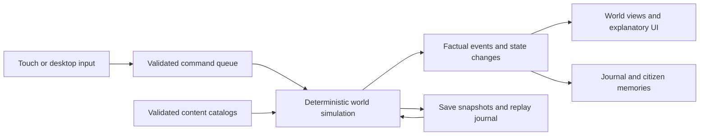

# Brackenward game design and build specification

Revision 1.1 · 12 October 2026 · Project directory: `~/dev/brackenward`

**Status: implementation authorized on 12 October 2026.** This is the contract for the complete first release, its intermediate milestones, and its acceptance tests. Implementation evidence and outstanding gates are tracked in `reports/STATUS.md`; planned systems below are not automatically implemented or validated. The current checkpoint is M7 in progress, with the automated M6 Charter/native subset and complete revised-policy v6 Winter matrix passing, broader long-run scenarios in progress, and physical Android certification still pending. The user authorized continuing M1 and all later implementation without waiting for phone tests, and publishing checked per-commit development APKs. Physical and human release gates remain pending until exercised.

Brackenward is an offline colony simulation about making a woodland refuge worth staying in. The player lays out a settlement, assigns work, sets policies, and watches a small group of adults turn those intentions into daily life. Its interest comes from shared resources, competing uses of time, personalities, geography, and consequences that persist. A phone player must be able to understand a problem where it happens and do something useful about it without reading a wiki.

The first release supports Android, Windows, macOS, and Linux. Android is a release gate from the first playable milestone. Both portrait and landscape are fully playable. There is no direct player avatar, subscription, advertising, paid acceleration, online requirement, or simulation while the app is closed.

Plan the initial release as free downloadable Android and desktop builds. There is no account, entitlement check, external economy, or paid content tier. Publishing checked development APKs on each main-branch commit is authorized; finished production releases remain a later gate.

## Contents

1. [Vision and boundaries](#1-vision-and-boundaries)
2. [Theme and the player experience](#2-theme-and-the-player-experience)
3. [Time and the core loop](#3-time-and-the-core-loop)
4. [Mobile controls and information](#4-mobile-controls-and-information)
5. [Citizens and relationships](#5-citizens-and-relationships)
6. [Jobs and movement](#6-jobs-and-movement)
7. [Resources and the economy](#7-resources-and-the-economy)
8. [Construction and rooms](#8-construction-and-rooms)
9. [Plants and farming](#9-plants-and-farming)
10. [Animals and food gathering](#10-animals-and-food-gathering)
11. [Production and research](#11-production-and-research)
12. [Weather and hazards](#12-weather-and-hazards)
13. [Defense and injuries](#13-defense-and-injuries)
14. [The valley and expeditions](#14-the-valley-and-expeditions)
15. [Trade and neighbors](#15-trade-and-neighbors)
16. [Story generation and pacing](#16-story-generation-and-pacing)
17. [Progression and endings](#17-progression-and-endings)
18. [World generation](#18-world-generation)
19. [Art audio and assets](#19-art-audio-and-assets)
20. [Technology and architecture](#20-technology-and-architecture)
21. [Data and simulation contracts](#21-data-and-simulation-contracts)
22. [Saving and mobile lifecycle](#22-saving-and-mobile-lifecycle)
23. [Performance and platform delivery](#23-performance-and-platform-delivery)
24. [Implementation milestones](#24-implementation-milestones)
25. [Verification and acceptance tests](#25-verification-and-acceptance-tests)
26. [Playtesting and balance gates](#26-playtesting-and-balance-gates)
27. [Handoff rules and evidence](#27-handoff-rules-and-evidence)
28. [Sources and local asset inventory](#28-sources-and-local-asset-inventory)

## 1 Vision and boundaries

### 1.1 What success looks like

A player notices that meals are waiting at the hearth because the cook is hauling distant stone. They tap the hearth, see that explanation, give cooking precedence, and watch the cook return. Later, the same cook helps an injured hunter, becomes their friend, and requests a garden bench near the kitchen. A flood threatens the low fields. The player has enough notice to harvest early, move stored food, or accept a smaller harvest. The journal records what actually happened and who helped. These are stories made by interacting systems.

The game should be warm, observant, occasionally tense, and capable of loss. It must not mock failure, conceal essential rules, erase a colony through an unannounced dice roll, or praise every tap. Learning should feel like noticing how a place works.

| Pillar | Required behavior | Failure condition |
| --- | --- | --- |
| Orders become visible work | Every delivered item, building, meal, rescue, and harvested crop has a worker, route, and visible action | Remote resources disappear and a building materializes |
| Understandable consequences | Inspectors expose causes, relevant numbers, deadlines, and available actions | An unexplained status requires outside documentation |
| Citizens matter | Names, roles, preferences, memories, and relationships persist and affect behavior | Citizens are interchangeable production counters |
| Phone sized decisions | Useful actions fit a short session; pause is always available | Survival requires precise dragging, fast tapping, or watching a countdown outside the app |
| Honest difficulty | Announced threats use fixed rules and bounded uncertainty | Threats secretly scale with stockpile value or undo a successful plan |
| Recovery has agency | A setback leaves choices, losses remain recorded, loading is always allowed | A failed harvest automatically becomes an irreversible cascade |

### 1.2 Exact first release scope

One settlement; one 128 × 128 tile surface map; a 9 × 9 regional map; 4 initial adult citizens; at most 20 resident citizens, 12 domestic animals, 32 wild animals, 6 hostile humans, and 8 visiting humans simultaneously. Expeditions contain 2–4 residents and at most 2 pack goats. Expedition residents count toward the 20 limit. Maps never expand during a campaign.

The content catalogs in this document are exhaustive for version 1.0. Variants that share a definition are cosmetic. Additional buildings, illnesses, items, enemy types, technologies, or needs are not implied by a theme or illustration.

There are no underground floors, fluid physics, structural collapse, electricity, plumbing, diseases that spread between citizens, bodily waste, ammunition, equipment durability, procedural crafting quality, hereditary genetics, pregnancy, children, slavery, torture, organ harvesting, sexual content, or real-world political factions. There is no local combat map for expeditions. No multiplayer, cloud saves, mod API, controller support, browser release, achievements service, or generated-language model is required for 1.0. iOS is a later port with an explicit device-validation gate, not a promised launch platform.

The game takes inspiration from the observation, assignment, and emergent consequences of colony simulations. It does not reproduce another game's interface, fiction, art, writing, or unusually punitive mechanics.

### 1.3 Difficulty

Two modes use identical recipes, research, personalities, and economy. Mode is selected at creation and can be changed from Settings while paused; the change is recorded in the journal and applies only to future incident scheduling. Existing threats keep their previewed rules.

| Mode | Hostile raids | Citizen death | Other rules |
| --- | --- | --- | --- |
| Standard, default | Scheduled under §16 limits | Possible through sustained neglect or untreated injuries | All advance warnings and automatic pauses enabled initially |
| Hearthside | None scheduled; wildlife still defends itself | At zero health, a citizen becomes recovering for 2 days and wakes at 40 health; no resurrection of previous deaths | Weather, shortages, work conflicts, and expedition losses still apply; expedition health cannot fall below 1 |

Settings describe the actual differences without calling either mode easy, authentic, or the intended way to play. There is no hidden difficulty adjustment. Reloading and manual saves are unrestricted in both modes.

### 1.4 Shared interpretation rules

All distances are Manhattan tile distance unless a rule explicitly says path distance. Distance to a multi-tile object is the minimum distance to any occupied footprint tile. A range is inclusive. Durations expire when elapsed ticks reach the stated duration; conditions saying “below” use strict comparison. Counts/costs round only where specified, otherwise retain fractional progress in integer remainders. On equal choices, use shortest valid route, then lowest runtime ID; definitions without a runtime ID tie by ascending definition ID. A percentage speed bonus multiplies speed, not travel duration. No random failure is implied by a task, recipe, weather type, or text description.

All buildings, zones, items, needs, relationships, and timers that affect outcomes must be inspectable. A rule described as a limit is displayed before the action that encounters it. By default, actions and unlocks have no effects beyond those explicitly listed; art and names do not imply extra mechanics.

## 2 Theme and the player experience

### 2.1 Place and purpose

The Alder Vale once linked several small towns through maintained paths, storehouses, and hilltop signal beacons. Years of storms and neglect broke that network. Four travelers settle beside a ruined wayhouse to restore a refuge called Brackenward. Other communities still exist. Trade, cooperation, and occasional opportunistic theft are believable responses to scarcity.

The setting is lightly fantastical in its scale and visual charm, but all version 1.0 mechanics are physical and understandable. There are no spells or supernatural random disasters. A recovered bell, an orchard, and a room with a warm table are major accomplishments. Citizens wear work coats, scarves, boots, and visible tools. Enemies are frightened, self-interested people with retreat conditions, not endless waves.

Use muted moss, clay, cream, slate, berry red, and lamplight. Show attractive woods and water around a legible settlement. Work is satisfying to watch: hauling bundles, kneeling to plant, hammering in short sequences, passing bowls, tending a patient, and meeting under a tree. Do not fill the screen with floating reward numbers.

### 2.2 First session script

The standard new game begins paused at Spring 1, 06:00. The player selects one of three guaranteed viable sites, a seed, and a mode. A preview shows the site-specific tradeoff, first three days of weather, and starting residents. Defaults are Meadow Reach, a newly generated seed, and Standard. Editing names and appearances is optional. Skill or trait rerolling is absent; the initial roster is fixed for a reproducible and capable start.

The opening panel is: **“Four travelers. A ruined wayhouse. Make a place to stay.”** Buttons are **Begin** and **Look around**. Both enter the same paused map; Begin also enables the first task prompt. Look around leaves prompts accessible from the question-mark button.

| Step | Player action | World response | Completion evidence |
| --- | --- | --- | --- |
| 1 | Tap Mira and then Follow | Camera follows her at a comfortable zoom; card says what she can do | One citizen selected; no tutorial timer |
| 2 | Paint a small forage designation on highlighted berry bushes and confirm | Assigned citizens collect berries when time resumes | At least one real berry delivery, not just an issued command |
| 3 | Place the suggested 8 × 6 sleeping lodge outline | Four beds, walls, and a door become individually buildable blueprints | Preview shows total cost, reachable doors, and order of construction |
| 4 | Resume at 1× and inspect the hearth | Cook makes meals from actual delivered ingredients | One completed meal batch; inspector explains ingredient and fuel use |
| 5 | Make an 8-tile turnip field | A worker prepares, sows, and later harvests it | Eight planted tiles; next harvest shown in days and hours |
| 6 | Inspect Mira's Cooking First priority, or change it to First if it was changed | Her next eligible cooking assignment follows that priority | Work inspector identifies Cooking First as the reason; opening defaults still follow §6 |
| 7 | Pin the food forecast | Shows portions, daily demand, next harvest, and bottlenecks | Forecast visible; prompt ends |

Each step is a dismissible one-sentence card with an animated gesture and a highlighted target. It never intercepts the pause button. Skip marks the current lesson skipped, not completed. “Show me” replays it. Triggered lessons for winter, injury, research, and expeditions each teach one action in at most 3 cards. They use actual current objects, pause on opening, and do not grant free resources. A deleted or blocked lesson target is reselected from valid candidates; if none exists, show the actual prerequisite instead of pointing at empty space.

The opening map has a usable hearth, supply cart, four bedrolls, and enough resources to survive while learning. The lodge is an improvement over bedrolls, not an undisclosed survival deadline. Other than the starting equipment in §7, nothing appears merely because a tutorial is active.

### 2.3 Sessions and campaign length

A 3–5 minute session should allow inspecting a problem, issuing a plan, and observing one meaningful result. A 20-minute session can finish a building, handle an incident, or send an expedition. A first charter should normally take 33–48 in-game days, roughly 6.6–9.6 hours at uninterrupted 1× or 3–5 hours with typical use of faster speeds and pauses. These are playtest targets, not completion timers.

## 3 Time and the core loop

### 3.1 Units

| Quantity | Canonical value |
| --- | --- |
| Simulation rate | 10 fixed ticks per simulated second |
| One game hour | 300 ticks = 30 simulated seconds |
| One game day | 7,200 ticks = 720 simulated seconds = 12 real minutes at 1× |
| Season | 8 days; Spring, Summer, Autumn, Winter |
| Year | 32 days |
| Speeds | Paused, 1×, 2×, 4×; simulation rules identical at every speed |
| Work unit, WU | One simulated second of productive work by skill 0 at rate 100% |
| Tile | 2 fictional meters; movement uses grid distances, not physics meters |
| Need units | 0–1,000 internally, shown as rounded percentages |
| Health | 0–100 integer points |

Durations in days or hours always mean game time unless explicitly marked real time. “Day 1” is the first calendar day. Simulation time begins at tick 1,800, corresponding to 06:00. Daily counters reset at 00:00, not on loading or resuming.

### 3.2 Loop

Inspect → designate or set a policy → workers choose feasible tasks → observe production and relationships → see changing forecasts → respond or expand. Daily planning concerns food, work, shelter, and risk. Seasonal planning concerns reserves, crop windows, warmth, and expedition absences. Long-term planning concerns research, trade relations, and the restored refuge.

Opening Build, Work, Valley, Journal, the full inventory screen, or a blocking choice pauses time and stores the previous speed. Closing an ordinary panel leaves time paused. Confirming a placement is the explicit exception: restore the exact speed from before the tool or its menu chain opened (1×, 2× or 4×), and remain paused if entry was paused. Cancel leaves time paused. An explicit Pause, backgrounding, storage failure or world replacement cancels automatic resume. A small citizen/building inspector does not pause, except when opened by a critical alert. Placing a blueprint is always done while paused. A setting can leave inspectors paused as well; default off.

The player can issue ordinary commands while paused. They commit at the next simulation tick in command sequence order. The UI shows pending commands immediately but distinguishes pending from accepted state. Resuming does not bypass validation.

### 3.3 Pause policy

Default automatic pauses occur at a hostile party's arrival, first downed citizen in an incident, a new building fire, expedition decision, departure ultimatum, or food runway crossing below 0.5 days. Each incident pauses once per reason; inspecting it does not trigger another pause. Acknowledge resumes only on explicit tap. Weather forecasts and low-priority notices do not pause. Settings can disable these individually; the pause button remains visible.

Returning from background always shows a paused **“While you were away, nothing advanced”** panel with the three most recent unresolved notices. Real-world clock changes never age food, progress work, or alter a forecast.

## 4 Mobile controls and information

### 4.1 Layout

Use native logical display units derived from the platform density, called dp below. Android's usable safe rectangle excludes cutouts, gesture areas, and system bars. The minimum tested usable layout is 360 × 640 dp portrait and 640 × 360 dp landscape. Desktop minimum is 960 × 600 logical pixels. Every action target is at least 48 × 48 dp, with at least 8 dp between separate destructive and constructive actions. Body text is 16 dp at the default scale; larger text remains available at 125% and 150%. Phone feedback revised the original 18 dp default. Status and tool padding stay compact while every touch target remains at least 48 dp. Direction controls use drawn arrows rather than clipped words. Fonts render from scalable distance fields and world sprites use nearest filtering to avoid enlarged raster glyphs and blurred pixel art. Text scale options are 100%, 125%, and 150%; panels scroll at larger scales instead of clipping controls.

Portrait has a 56 dp status row at the top, the world in the middle, and a 64 dp navigation row at the bottom. Navigation entries are Build, Work, People, Valley, and Journal, each with a picture and a label. Food, bed capacity, and the most urgent unresolved issue occupy the status row; tapping opens the relevant explanation. The pause/speed cluster floats above the lower right navigation edge and never moves when a panel opens. The menu button sits at upper right. Notifications sit below the status row with at most one expanded notice.

At 125% or 150% text on usable widths below 600 dp, navigation wraps into two 64 dp rows, three entries then two; it does not shrink labels or touch targets. Status summaries wrap into a second 48 dp row at the same threshold. Full-screen sheets scroll below their pinned Close/Pause strip. The available world area may shrink, but no operation becomes inaccessible.

Landscape uses the same status and navigation controls, with a 320 dp inspector on the right. Portrait inspectors are bottom sheets at 35%, 65%, and full usable height, with a visible drag handle and matching expand/collapse buttons. Full-height sheets preserve a 48 dp top strip containing Close and Pause. Do not depend on dragging to resize.

The world uses a 32 dp tile at default zoom, backed by 16 × 16 pixel art. Zoom limits are 2–64 dp per tile, allowing eight times the former map width at maximum zoom-out. Preserve the tile under the zoom anchor and persist this wider range in device settings schema 5; schema 4 preferences migrate with every value intact. At low zoom, citizens remain recognizable 24 dp selection markers and stockpiles become aggregate piles. Below 16 dp/tile, show a 24 dp portrait in a fixed 32 dp pin above roofs and night tint. Nearby visible home residents share a pin with a count and stacked outline; a cross shows a downed member or a carrier with a patient. Process IDs in ascending order, merge groups when a new point is within 28 dp of a member and the merged screen bounds stay at most 64 dp on either axis, and anchor each pin at the members' mean interpolated displayed position. Use the selected member's portrait, otherwise the lowest ID. All members use that displayed center for the normal 48 dp map target and existing complete object chooser. Hide dead, departed, carried and offsite residents exactly as world sprites do. Reuse at most twenty pin nodes, refresh appearance/visibility while paused, and retain a shape/thickness selection cue in high contrast. At normal zoom restore sprite-position hit testing. Explicit Follow from an overview zoom returns to 32 dp/tile before following the individual. Labels appear only for a selected object or an alert. A 2 dp outline plus icon identifies selection; hue is never the only cue.

```text
PORTRAIT                               LANDSCAPE
┌ Food  Beds  Issue            Menu ┐  ┌ Food  Beds  Issue                 Menu ┐
│ Notice with View and Dismiss      │  │ World                  │ Inspector    │
│                                  │  │                        │              │
│             WORLD                │  │                        │ Why / Action │
│                                  │  │                 Pause  │              │
│ Inspector or placement preview   │  ├ Build Work People Valley Journal ──────┤
│                      Pause 1 2 4 │
├ Build Work People Valley Journal ┤
```

### 4.2 Gestures and commands

| Input | Normal world | Designation mode |
| --- | --- | --- |
| Tap, movement ≤8 dp and duration <350 ms | Select highest visible eligible object | Start a fresh one-tile preview, or place the current building footprint |
| One-finger drag after 8 dp | Pan camera | Draw rectangle or line; does not pan |
| Two-finger drag | Pan camera | Pan without changing the selection |
| Pinch | Zoom around midpoint | Same; suspend brush until both fingers lift |
| Long press ≥450 ms | Open a 48 dp row of objects under the finger | Show magnifier, then adjust endpoint; does not confirm |
| Confirm button | Applicable card action | Submit highlighted valid tiles as one transaction |
| Android Back or Escape | Close highest modal, then inspector, then open pause menu | Cancel unconfirmed designation first |

Choosing any placement or designation action preserves the current camera position and zoom and stops following a resident. Its preview begins at the visible map center. Preserve the actual visible center when guidance, inspectors or placement panels change their layout offset, including at map edges. Save that actual center in device preferences. A tap starts a fresh one-cell stroke, so a door or a one-tile wall needs only a tap and Confirm; it never joins the previous preview's endpoint. Dragging creates a new line or rectangle from that gesture's starting tile. Nudge buttons adjust the preview without requiring a precise drag.

Choosing Gather wood (or another resource) enters rectangle designation mode. The preview counts matching, nonempty, unmarked resources, rather than all enclosed tiles. Confirm creates one job per matching resource; each resource retains a visible mark until completion or cancellation. Eligible Gathering workers take the next marked job automatically. A marked mineral deposit produces successive per-unit jobs until depleted. Repeating a rectangle never duplicates existing jobs. Irrelevant tiles inside the rectangle are ignored.

Confirm immediately leaves a persistent hatched map mark derived from the saved pending command, without advancing logical time, needs, inventory or work. Another placement can be confirmed while paused; rapid repeated Confirm on one preview still submits only once. Pending build footprints reserve their layer for subsequent previews, retaining the separate floor/building layers and bridge-deck rule. Process every receipt when simulation resumes, replace pending marks with actual orders, and expose any rejection. Save queued commands at the same tick within the normal durable window using a verified snapshot; recovery reconstructs their marks.

Dragging in designation mode creates a preview only. Rectangles have nudge arrows and numeric width/height labels; lines are axis-aligned. A magnifier appears 72 dp above the primary finger without covering Confirm. No action requires long press, multitouch, or a precise edge hit: zoom buttons, pan mode, selection list, and nudge buttons are always available. Multi-object tapping ranks citizen > hostile > domestic animal > station > blueprint > plant > terrain; the chooser includes every overlapping object.

Camera controls: no rotation, no inertial pan by default, no edge scrolling on phone. Desktop supports left select, right cancel, middle drag, wheel zoom, WASD/arrow pan, Space pause, 1/2/3 for 1×/2×/4×, B Build, J Work, P People, V Valley, L Journal, and Escape close. Rebinding is supported for these actions. Menu > Settings > Keyboard controls captures a key or modifier shortcut, names conflicting assignments, supports cancellation, and restores all defaults. Rebound manual pan stops camera follow. Device settings schema 3 upgrades earlier preferences without changing cameras or tutorial state. No keyboard shortcut is required for any feature.

Panel action identity is separate from its displayed caption. Resident/building/animal names and other detail titles remain literal data, including names such as Build, Menu, Work, Delete saves and Save problem. They cannot populate navigation controls, suppress autosaves, close a recovery panel or reactivate a stale deletion callback. Modal presence depends on the panel itself. Built-in navigation retains explicit routes and translation keys; literal detail headings retain their full names without interpreting message parameters. Menu > Manage saves opens campaign management, including campaign and named-snapshot deletion.

Building rotation is a 48 dp button cycling 0°, 90°, 180°, 270°; preview always shows entrances and work positions. A mirrored left-handed layout moves the pause cluster and portrait action buttons to the left without changing label reading order.

### 4.3 Information hierarchy

An inspector has four parts: name and current state; the next consequence and time; the primary feasible action; expandable details. Example: **“Hearth — Waiting for wood. 3 meals left, about 9 hours for 4 people. [Mark nearby wood] [Change jobs].”** Details show exact stock, reserved stock, assigned worker, route, and recipe.

Every unavailable action has a reason and a navigation link to the missing prerequisite. A disabled button alone is a bug. A reason has a stable code and localized text: no eligible worker, priority lower than another job, missing input, all input reserved, storage full, route blocked, unsafe route, wrong season, insufficient skill for an expedition, unresearched, insufficient space, or paused by player. “Cannot do this” is insufficient.

Forecasts distinguish certainty: **Stored** is exact; **Scheduled** assumes currently assigned work and passable routes; **Potential** assumes weather and staffing continue. Food runway is edible nutrition divided by current consumption, not item count. Grain that cannot yet be cooked appears in Potential, with the missing station or fuel visible. Spoiling supplies are excluded beyond their expiry. An expedition's packed food is excluded from home stocks.

On any loss or blocked task, the player can tap **Why** to see the relevant cause chain, such as “Harvest late → farmer treating Oren → injury from boar → hunt order.” Show at most four edges initially; expand reveals the full retained chain. Do not invent causality from simultaneous events.

### 4.4 Alerts and accessibility

Four severities: information (neutral circle), opportunity (leaf), warning (amber triangle), and critical (red octagon). Pair each with text and a distinct silhouette. Merge repeated warnings by cause and affected area; e.g. “6 beds cold” replaces six popups. Reissue only after severity rises or the condition was resolved for at least one game hour. Show at most 3 compact alerts; the rest live in a scrollable list with the critical count always visible.

Include reduced motion, no screen shake, independent music/effects/UI sliders, captions for warning sounds, high-contrast selection, large text, left-handed layout, and haptics off by default. Weather particles and ambient chatter cannot conceal threats or selection. Every hover explanation must also open on tap. Voice reading and complete screen-reader operation are not promised for 1.0; visible text, focus labels, keyboard navigation, and semantic control names are still required so a later accessibility pass has a usable foundation.

## 5 Citizens and relationships

### 5.1 Resident record and initial group

Each resident has an immutable numeric ID, editable display name, cosmetic appearance, two traits, one preferred job category, one preferred food tag, seven skill levels, skill XP, needs, health, equipment slots, current task, memories, and pairwise relationships. All are adults. Age is cosmetic and does not advance into death. Gender and appearance have no mechanical effect.

| Resident | Skills above zero | Traits | Preferred work | Preferred food |
| --- | --- | --- | --- | --- |
| Mira | Cooking 3, Care 2, Craft 1 | Kind, Homebody | Cooking | Vegetable |
| Oren | Build 3, Craft 2, Guard 1 | Steady, Sociable | Building | Grain |
| Tavi | Field 3, Guard 2, Care 1 | Outdoorsy, Restless | Gathering | Berry |
| Sela | Study 3, Craft 2, Field 1 | Curious, Private | Research | Mushroom |

Skills are Field, Build, Craft, Cooking, Care, Study, and Guard, each 0–5. XP thresholds for levels 0–5 are 0, 400, 1,200, 2,400, 4,000, and 6,000 productive WU. A completed productive WU awards one XP in the job's skill; walking, waiting, canceled work, and repeated failed attempts award none. Combat awards 2 Guard XP per successful attack and 10 per completed defense incident, capped at 50 per day. Skill changes productive rate to `1,000 + 100 × level` per thousand before trait and tool modifiers.

Initial and newcomer XP equals the threshold of each starting level. Accumulate fractional XP alongside productive work, but finalize it only for the WU of a completed task/batch, preventing cancellation farming. Resumed partial work retains its pending XP. Level 5 can retain further XP for statistics without gaining another rate bonus.

Initial relationship scores are 20 for Mira/Oren and Tavi/Sela, and 0 for all other pairs. Initial fullness/rest/morale are 750/900/650; health is 100. Newcomers begin at 800/800/600, health 100, and relationship 0 with residents. §16 fixes newcomer generation.

### 5.2 Needs and daily life

All fractional need changes retain an integer remainder so totals over a full day are exact. Fullness loses 1,000 per day, whether awake or asleep. A meal or travel ration restores 500. Eating raw edible produce restores 250. Citizens seek food at fullness ≤350 and eat one portion, choosing the oldest edible allowed food, then preferred food on an age tie, then item ID. Before interrupting an assigned task, verify that a safe reachable allowed portion will actually be available after releasing that task. Include its own releasable reservations and carried food at the carrier's current logical tile; exclude held trade/expedition/payment/opportunity/supper-bank supplies whose reservation survives release, and normal work escrow that would remain at the site. Previewing this release changes no saved field. If no portion is feasible, keep current productive work or rest so a cook can finish preparing food instead of dropping and fetching the same inputs every second. Hunger and starvation damage continue normally. At fullness 0, a drafted defender yields its current defense task to self-care or permitted ordinary work; retain the draft order and resume defense after eating. Critical rest still precedes ordinary work. A sleeper with no feasible food recovers minimum rest before rising to prepare food (rest 300); feasible eating can interrupt once critical rest exceeds 100, while life-critical eating retains its existing priority. Raw meat, fish, and grain are inedible; no secret food poisoning system exists.

Eating takes 2 WU without skill/tool modifiers. Reserve and carry one portion, move to a table within 12 path tiles of its pickup tile if a seat is free, otherwise eat safely at the pickup tile. Choose shortest safe route, then table ID, then row-major seat tile. Other active tasks and scheduled/active communal supper slots reserve their seats. Eating reserves its portion rather than a productive work position, so a person resting or another eater on the shared cart tile cannot prevent it. Consume and restore fullness at completion, clamped to 1,000. An interruption preserves the held portion; spoiled food must be replaced. Eating at a table has no hidden nutrition or morale bonus beyond its potential social use.

At zero fullness, a visible starvation clock starts. After 6 continuous hours at zero, lose 5 health per hour until fed or dead. Any food resets this clock. The first zero-fullness alert states the grace period and names the affected resident. Food shortage alone cannot kill someone without many game hours of warning.

Rest loses 37.5 points per waking hour, represented exactly by alternating 37/38 numerator increments over the existing 300-tick hour and saved remainder. Sleeping restores 75/hour in a bed, 60 in a bedroll and 45 on the ground; waking loss does not also apply. From rest 300 to 900, those take 8 hours, 10 hours and 13 hours 20 minutes. A bed balances 16 waking hours against 8 sleeping hours. Residents seek sleep at rest ≤300 (≤500 when preparing an expedition), or in their preferred 22:00–06:00 window only at rest ≤600. Night shift offsets that preference by 12 hours; it cannot force an energetic resident to bed. Complete ordinary sleep at rest ≥900 at any clock time; sunrise alone does not end needed sleep. At rest ≤100 refuse ordinary work and sleep in the nearest safe place. If the assigned bed cannot be reached from safe walkable ground, sleep there for this period, retain the assignment and show “Assigned bed unreachable: clear access or reassign bed.” Ground sleep gives the ground recovery rate and no assigned-bed memory; try the bed again next time. Ordinary sleep eligibility is identical before interruption and replacement: needs sleep, and either fullness >350 or rest ≤100. A hungry sleeper at rest ≥300 may rise to obtain or prepare food even if no portion is yet feasible; below that it keeps recovering minimum rest. Feasible eating still interrupts normally, and a hungry productive worker cannot release/reacquire the same job for ineligible sleep. The same rest rates, readiness and hungry-rest exception apply to expedition camp sleep. Expose actual rates and thresholds in resident/bed cards. This changes future rules in content v6, while loading v5 normalizes only headers and retains acknowledged needs/remainders/jobs exactly.

Resident and bed cards expose assignment and unassignment. The public `assign_bed` command takes `citizen` and `target` IDs; target 0 unassigns. A completed, safe, reachable bed/bedroll must be free or already assigned to that resident. An occupied bed names its owner and requires explicit unassignment first; no silent swaps. Reject dead/departed residents, residents away from home, destroyed/non-bed targets and burning beds with an actionable reason. Applying the command costs no WU or goods and grants no movement/rest: release the previous bed, reserve the new one and reset consecutive assigned-bed sleep ticks. Keep previously earned timed memories. Retarget an existing sleep task without resetting an in-progress movement edge; at rest ≤100 keep immediate safe-ground sleep for this rest period. Downed patients are not moved by assignment. New arrivals choose a reachable safe free bed before a bedroll, roofed before outdoor within each kind, then lowest ID. Existing residents change assignments only through a player/policy command or the established new-bed construction upgrade. Schema 21 adds this command; migration from schema 20 changes only the revision header and retains all resident, bed, map and historical values.

Between 18:00 and 20:00, residents prefer leisure once they have eaten and critical tasks are handled. Leisure means sitting, talking, visiting a memorial, or walking to a garden. They spend up to 2 hours in it per day. Player urgency can use this time, but the missed-leisure mood modifier is then visible. Schedules cannot be edited hour by hour in 1.0; the Work panel offers Normal or Night shift per citizen. Night shift offsets the preferred sleep window and leisure by 12 hours. Shift changes take effect after the current needs task.

Warmth is contextual rather than another refill meter. Ambient temperature, a cloak, and heated rooms determine comfort (§12). There is no thirst need. Springs and wells provide drinking water as part of living at the site; water hauling exists only for firefighting. This omission is an intentional limit on routine chores.

### 5.3 Morale

Once per game hour, calculate a target from base 600 and the following active modifiers, clamp it to 100–900, then move actual morale toward it by at most 60. Never jump actual morale to the target. Effects of the same kind do not stack unless explicitly stated.

| Condition | Target modifier | Duration or condition |
| --- | --- | --- |
| Slept in assigned bed | +80 | 1 day after at least 4 hours of sleep there |
| Ate 3 distinct ingredient tags | +60 | Until the next midnight |
| Had comfortable warmth | +60 | Currently comfortable and for 2 hours after leaving |
| Shared leisure with a friend | +40 | 1 day |
| Completed at least 1 hour of leisure | +60 | 1 day |
| Worked at preferred category | +40 | After 30 WU; 1 day |
| Fullness below 200 | −250 | While condition holds |
| Rest below 200 | −200 | While condition holds |
| Health below 60 | −150 | While condition holds |
| Cold | −150 | While condition holds |
| Ate raw produce | −50 | 6 hours; no health penalty |
| Missed yesterday's leisure | −60 | Until 1 hour of leisure completed |
| Friend died | −180 | 3 days; linearly declines toward zero |
| Other resident died | −80 | 2 days; linearly declines toward zero |
| Conflict or broken accepted promise | −60 | 2 days |
| Fulfilled personal request | +100 | 2 days |

Below 250 morale for 6 continuous hours causes a visible **Taking a break** state lasting 6 hours. The citizen eats, sleeps, and takes leisure, accepting only escape and self-preservation actions. Finishing the break grants +120 actual morale once, with a 2-day cooldown. They do not attack others, sabotage buildings, or destroy stock. The alert identifies the three strongest causes and offers workload, bed, food, and warmth actions.

Below 200 morale for 24 continuous hours starts a departure notice with another 24 hours to improve conditions. Raising morale to 300 cancels it. At expiry, a mobile citizen leaves along a safe boundary route; an injured or trapped citizen waits until able to leave. Their carried personal equipment leaves with them, communal inventory does not. The journal records the departure. Do not force a rescue event or spawn an obedient replacement.

### 5.4 Traits

| Trait | Exact effect |
| --- | --- |
| Kind | +20% Care work rate; rescues give +25 relationship instead of +20 |
| Homebody | +40 morale target while working inside a room; −40 while on expedition |
| Steady | Taking-a-break threshold is 200 rather than 250; all other thresholds unchanged |
| Sociable | Shared leisure relationship gain +1; needs 90 minutes rather than 60 for the leisure morale benefit |
| Outdoorsy | +40 morale target when working outdoors; no raw-produce mood penalty |
| Restless | +15% move speed; assigned-bed morale benefit is +40 rather than +80 |
| Curious | +20% Study work rate; discoveries grant +60 morale target for 2 days |
| Private | Alone leisure also grants the friend-leisure +40 benefit; shared conversation gain is 1 instead of 2 |

Apply rate modifiers multiplicatively with integer remainders. Traits have no undocumented secondary effects. A resident cannot be both Sociable and Private. All other pairs are valid; exactly two distinct traits are selected for generated newcomers.

### 5.5 Relationships and personal requests

Relationship scores are symmetric integers from −100 to 100. Completing a half-hour shared leisure conversation within 2 tiles gives +2, modified by traits, once per pair per day. Finishing work on the same building during the same day gives +1 per pair once that day. Carrying a downed citizen to safety gives +20 once per injury incident. Scores ≥40 are friends; scores ≤−40 are strained. Scores otherwise decay 1 point toward zero every 8 days without interaction. Friend status is a derived label, not a separate flag.

On starting leisure, choose a reachable free seat within 32 path tiles: first one within 2 tiles of a friend taking leisure, then a garden bench, then a table, then a safe grass tile beside the cart. Private residents first seek a seat more than 2 tiles from others. Within a preference tier use shortest route then object/tile ID. Conversations pair unpaired nearby leisure participants in ascending citizen ID, choosing nearest partner then partner ID; one citizen has one conversation at a time. Sleeping, eating, travel, or an emergency resets incomplete conversation time. A workday without a friend still permits the ordinary leisure benefit.

Two strained residents sharing a work position never fight. After 4 hours working in the same room, at most once per pair per 2 days, create a disagreement: both get the conflict mood modifier and lose 3 relationship. Moving one assignment or providing separate leisure space avoids recurrence. Choosing **Mediate** creates a 12 WU Care task requiring both participants within 3 tiles; completion gives +8 relationship and removes this disagreement's mood modifier. There are no romantic or hereditary systems in 1.0.

Every 4 days at 08:00, the eligible resident with the oldest unoffered request is selected, ties by resident ID. At most one personal request may be active colony-wide. Choose the first unmet preferred request below, then cycle in table order. The request is optional; declining has no penalty. Accepting gives a deadline 4 days later, displayed before confirmation. Success gives the request mood benefit and a journal entry; failure gives the broken-promise modifier only to that resident. Conditions already satisfied complete immediately, once per request cycle. Persistent bed/garden/tool conditions are checked at acceptance; research and successful-trip progress is measured from the offer, so progress while the offer is pending counts. Supper requires a completed half-hour session after the offer, or a currently completed session at acceptance. An unanswered offer is replaced without penalty at the next four-day offer date.

| Request | Eligibility | Completion |
| --- | --- | --- |
| A quiet bed | Private or Homebody | Assign a bed in a roofed room with at most 2 beds |
| A garden seat | Outdoorsy or Field preferred | Build a garden bench within 3 tiles of at least 4 planted field tiles |
| Supper together | Sociable or Kind | Resident and 2 others complete half an hour of leisure at the same table |
| Time to learn | Curious or Study preferred | Resident completes 60 WU of research |
| A better tool | Craft or Build preferred | Equip a forged toolkit |
| Walk the valley | Restless or Gathering preferred | Resident returns from any successful expedition |

## 6 Jobs and movement

### 6.1 Categories and player settings

| Category | Tasks | Skill |
| --- | --- | --- |
| Care | Carry injured, treat, mediate, memorial preparation | Care |
| Cooking | Cook meals, prepare travel rations | Cooking |
| Growing | Prepare fields, sow, harvest, irrigate via passive well coverage | Field |
| Gathering | Forage, cut trees, collect stone/clay/ore, fish, hunt | Field; attacks use Guard |
| Animals | Tame, feed, collect eggs/milk, lead to pen, slaughter | Field |
| Building | Construct, demolish, repair, install bridges and paths | Build |
| Crafting | Textile, tools, medicines, charcoal, brick, metal | Craft; medicine uses Care |
| Hauling | Transport loose items or station inputs | No skill multiplier |
| Research | Work on selected project | Study |
| Guard | Hold a defense point, escort a hunt, patrol during an alert | Guard |

For each category per citizen, choose First (3), Normal (2), Last (1), or Off (0). Default all Normal except Research Last and Guard Last. Starting preferred category is First; Mira also has Care First. Critical rescues and firefighting use every mobile resident unless that citizen is on expedition or taking a break. The Work panel explicitly says these emergency tasks override ordinary Off settings. Disabled ordinary categories are never silently re-enabled.

Task priority set by the player is Low (1), Normal (2), or Urgent (3). It is separate from worker category preference. “Do this next” pins one task to one citizen; it expires on completion, cancellation, or a clear infeasibility error. It cannot override sleep at rest ≤100, eating at fullness 0, danger avoidance, or Taking a break.

### 6.2 Assignment algorithm

Every 10 ticks, process idle or interrupted residents in ascending citizen ID. Use the following precedence, in order: immediate escape; downed state; life-critical self-care (fullness 0 or rest ≤100); emergency rescue/fire task; drafted defense command; ordinary eating/sleep needs; scheduled leisure; pinned feasible job; ordinary work; safe idle leisure. A patient accepts treatment while downed. Urgent work bypasses scheduled leisure, not hunger or sleep.

Feasibility requires allowed category, unlocked definition, all required inputs available or deliverable, reserved work/output space, reachable safe route, and valid world target. Enumerate at most the nearest 32 feasible jobs in each enabled category using path lower bounds; if none qualify, expand to all jobs in that category. Choose the lexicographically greatest tuple `(task priority, category preference, preferred-work bonus 0/1, skill level, negative path cost, negative job ID)`. A job may advertise an emergency tier above all ordinary priorities only for rescue, fire, or immediate escape. Aging raises a waiting ordinary job's task priority by 1 after 1 day and at most 2 after 2 days, capped at Urgent; show “Waiting since…” and the effective priority.

A resident keeps an assigned job until completion, a needs/emergency interruption, or infeasibility. They do not switch merely because a closer job appeared. Reevaluating after a player priority change occurs at the next safe checkpoint, at most 10 ticks later. Never discard completed construction or crafting WU when switching workers.

### 6.3 Job state and reservations

`Proposed → Ready → Reserved → Fetching → Moving → Working → Delivering → Complete`. From any active state, use `Blocked(reason)` when temporarily infeasible or `Canceled` when the target/order is removed. At most one worker owns a normal task. Construction can have 2 workers if there are distinct valid work positions; its WU contributions sum. Rescue is one carrier per patient. Each station has one production worker and one batch at a time.

Reserve input quantities, destination capacity, and the work position atomically before assignment succeeds. If any reservation fails, roll back all of them. Reservations have job IDs, not timers; explicitly release them on cancel, death, departure, expedition dispatch, and task abandonment. Revalidation runs each second and on navigation/inventory changes. A blocked job is retried after its dependency changes or after 5 seconds, not every tick. Prevent duplicate jobs with a key of `(order ID, target ID, operation, batch index)`.

Materials are carried in visible stacks. A resident carries at most 8 units; all inventory units have hauling weight 1. Repeated trips are planned automatically. Inputs deposited at a worksite become an escrow stockpile owned by that job. Consumption occurs atomically at batch completion; work begins only after all batch inputs are present. Cancellation before completion returns all unconsumed inputs and discards that batch's partial WU. Construction consumes delivered inputs only when its individual structure completes; cancellation returns escrow and removes the blueprint. No item is reserved by two jobs.

Fetching a job's own materials belongs to that job's category, even when the worker's Hauling category is Off. Independent haulers may deliver to its escrow through child delivery jobs owned by the same parent reservation; they cannot reserve those items a second time. The parent tracks exact delivered quantities and one shared batch progress/receipt. Ordinary job interruption retains progress; cancellation of the underlying order discards partial WU. Pending XP is granted only when the task eventually completes.

A finished batch remains in a station's output buffer until hauled. A station has capacity for exactly two full output batches; production pauses before starting a third. The inspector links to a valid stockpile or explains its absence. Hauling outputs, ingredients, and general stock uses one system. Avoid input/output ping-pong by never hauling a correctly filtered stored item merely to a different equal-priority store.

### 6.4 Navigation and safety

Use four-neighbor A* on the tile grid; Manhattan heuristic, neighbor order north/east/south/west, ties by lowest `f`, then `h`, then tile index `y × 128 + x`. Citizens share tiles and do not physically block each other. Render a small cosmetic offset when sharing. This prevents door congestion and traffic deadlocks without changing resource or work-position reservations.

Base movement takes 10 ticks per tile; stone paths take 8, mud and flooded tiles 15, snow 12. Apply movement traits and health penalties through a fixed-point accumulator. Health <50 makes travel 25% slower. No diagonal shortcuts. Deep river, walls, closed hostile gates, and elevation differences >1 are blocked. Friendly doors are passable; opening has no extra time cost. Bridges replace the water tile's movement cost with 10. Wildlife uses the same terrain graph but cannot open doors or gates.

Normal workers avoid tiles within 8 tiles of an active hostile, active fire, or marked dangerous hunt. If no safe route exists, show Unsafe route. A drafted defense order may enter danger, with its predicted risks visible. Civilians flee toward the nearest reachable rally zone or roofed room, with path cost as the tie-breaker. If neither exists, choose the safest reachable tile within 16 tiles, maximizing distance from danger then minimizing travel cost.

Repath when the next tile is invalid; release a blocked work position after 5 seconds. After 3 failed replans for the same target, park the job as Blocked and notify once. A construction preview rejects closing the last exit of an occupied room or trapping the builder at completion. Demolition and doors are always available without research. In a legacy or corrupted map with a trapped actor, offer an explicit “Remove blocking wall” order; do not teleport a citizen silently.

## 7 Resources and the economy

### 7.1 Item catalog

IDs are lowercase snake_case and never reused. One edible raw unit restores 250 fullness; a prepared portion restores 500. Recipe ingredient tags are preserved on meal stacks for variety and preference. A mixed stack must have identical item, tags, quality-free equipment state, and expiry bucket. There is no currency item; trade uses displayed barter values.

| ID | Display name | Stack limit | Base shelf life in days | Barter value per unit | Purpose |
| --- | --- | --- | --- | --- | --- |
| wood | Wood | 50 | Permanent | 1 | Building, fuel, tools |
| stone | Stone | 50 | Permanent | 1 | Building, basic tools |
| clay | Clay | 50 | Permanent | 1 | Bricks |
| iron_ore | Iron ore | 50 | Permanent | 2 | Smelting |
| fiber | Plant fiber | 50 | Permanent | 1 | Beds, textiles |
| charcoal | Charcoal | 50 | Permanent | 2 | Smelting |
| iron | Iron | 50 | Permanent | 5 | Tools, defenses, beacon |
| brick | Brick | 50 | Permanent | 2 | Durable stations and beacon |
| cloth | Cloth | 50 | Permanent | 4 | Clothing, furnishings |
| leather | Leather | 50 | Permanent | 3 | Vests and barter |
| herb | Medicinal herb | 50 | 16 | 2 | Treatment and medicine |
| vegetable | Vegetables | 50 | 6 | 1 | Raw edible, tag Vegetable |
| grain | Grain | 50 | 32 | 1 | Cooked only, tag Grain |
| berry | Berries | 50 | 3 | 1 | Raw edible, tag Berry |
| mushroom | Mushrooms | 50 | 4 | 1 | Raw edible, tag Mushroom |
| meat | Meat | 50 | 2 | 2 | Cooked only, tag Meat |
| fish | Fish | 50 | 2 | 2 | Cooked only, tag Fish |
| milk | Milk | 50 | 2 | 2 | Raw edible, tag Dairy |
| egg | Eggs | 50 | 4 | 2 | Raw edible, tag Egg |
| meal | Meal | 20 | 4 | 3 | One prepared portion |
| travel_ration | Travel ration | 20 | 24 | 4 | One portion, expedition food |
| medicine | Medicine | 20 | Permanent | 6 | Faster treatment |
| toolkit | Simple toolkit | 1 | Permanent | 5 | Basic worker equipment |
| forged_toolkit | Forged toolkit | 1 | Permanent | 12 | +15% productive rate in Build/Craft/Field |
| bow | Bow | 1 | Permanent | 8 | Ranged weapon |
| spear | Spear | 1 | Permanent | 6 | Melee weapon |
| cloak | Woolless cloak | 1 | Permanent | 8 | +12 degrees of comfort; made of cloth |
| vest | Padded vest | 1 | Permanent | 10 | Reduces incoming attack damage by 2 |

“Permanent” items do not decay. Rot deletes the expired unit and records spoilage; it does not spawn a new compost item. The cook chooses ingredients before they expire. Worksite escrow and animal feed remain subject to the same freshness rules as their physical location. Seeds are not inventory: known crops can always be sown in valid seasons; sowing WU represents selecting and preparing seed stock.

### 7.2 Starting supplies

The cart contains 24 meals, 40 wood, 30 stone, 12 fiber, 8 herb, and 8 travel rations. Each resident has one simple toolkit and one cloak. Mira and Sela carry spears; Tavi and Oren carry bows. Equipment is already assigned and is not also present in the cart. There are four built bedrolls and one built hearth, all on high ground. Initial hearth fuel buffer contains 4 wood, separate from the cart's 40. The cart is a 2 × 2 traversable structure with definition ID `supply_cart`, holds up to 300 units, accepts all goods, is movable only through a 20 WU Building task, and cannot be destroyed or crafted. Its contents remain in it while moving. It supplies the first rally point and is not a substitute for later preservation buildings.

Twenty-four meals cover 3 days for 4 residents at 2 portions each per day; the 8 rations add 1 more day if the player enables “Use expedition reserves at home.” This toggle defaults off, automatically offers itself in the first food warning, and never changes without confirmation. Starting meals age normally from creation tick, so harvesting and cooking matter before the reserve becomes a permanent buffer.

### 7.3 Storage and forecasts

A stockpile is a painted zone with item-category filters and priority Low/Normal/High. Each tile holds one stack. A store has a unit capacity in addition to stack limits. Stockpiles accept only selected categories; default for a new general zone is all materials and food, excluding equipment already worn. The cart is Normal priority. Haulers fill a valid higher-priority destination first, then shortest route, then lowest store ID. They remove a stored item only if its filter becomes invalid, the store is deleted, or an explicit Move goods order exists.

Spoilage accrues as age in base shelf-life ticks. Loose ground, carried items, the cart, and ordinary roofed stockpiles age at 1×. A granary ages grain, herbs, fiber, and all food at 1/2×; a root cellar ages food and herbs at 1/4×. Effects do not multiply. Expiry is per batch; splitting retains age, merging retains the oldest age, and moving does not refresh it. A stock card previews both current and destination expiry. No time passes in the background.

The main food number is total accessible edible fullness divided by 500, rounded down to portions. “Accessible” excludes all reserved quantities, expedition cargo, unreachable stores, and travel rations when the reserve-use toggle is off. Runway is portions divided by `2 × living home residents`, with spoilage simulated through that horizon and a zero-resident special case shown as “No residents at home.” It excludes prospective harvests. A separate harvest strip shows expected completion and yield. Warnings occur at runway <2 days, <1 day, and <0.5 days, explaining blocked cooking or absent workers when applicable.

Compute spoilage-aware runway with a sorted queue of accessible batches and their current-location expiry ticks. Forecast continuous demand of 1,000 fullness per resident per day, consuming the earliest-expiring batch first. Advance to the earlier of the next expiry or exhaustion, remove any expired unconsumed nutrition, and continue until the queue is empty. Use unrounded nutrition for this calculation; round only the displayed portions and time down to a quarter hour. Forecast no new cooking, movement, preservation change, or harvest in Stored runway. This conservative estimate does not count fullness already in a citizen's stomach. Scheduled/Potential projections can include those future actions but must remain separate.

### 7.4 Default policies

Hearth: make meals until home reserve reaches `2 × home residents × 2 days`, using oldest allowed ingredients; never consume travel rations as recipe inputs. Home reserve counts prepared meals only, so raw food does not halt cooking. Gathered raw produce remains available for emergency eating. Herbal bench: make medicine until stock is 4. No other station creates orders automatically on construction. Orders have a recipe, Repeat N or Maintain quantity, input filters, and priority. Maintain counts available plus in-progress output once, to avoid duplicate batches.

Equipment is assigned by slot: one toolkit, one weapon, one cloak, one vest. Auto-equip replacements is on, upgrades is off; player can enable upgrades per slot. Every inventory transfer occurs physically through the wearer or a delivery. Equipping takes 2 WU. Tools never wear out. A missing toolkit halves Build/Craft/Field work rate but never makes emergency shelter or food gathering impossible. Care, Cooking, Study, and Hauling do not need one.

## 8 Construction and rooms

### 8.1 Construction rules

A structure has an integer footprint, a rotation, work positions on adjacent passable tiles, material cost, WU, health, and unlock. Placement previews the full cost including room shells, identifies blocked cells and access problems, and never partially submits a footprint. For painted multi-structure orders, confirm explicitly says how many valid tiles will be submitted; invalid tiles remain unsubmitted and marked with their reason.

Anchors are the northwestern occupied tile of the rotated footprint. Default work positions are all orthogonally adjacent perimeter tiles, enumerated row-major and filtered for walkability/safety; construction chooses up to two distinct positions. The table's four seats are the two cells immediately north and two immediately south of its unrotated 2 × 1 footprint, rotated with it. A bench uses one north and one south seat at its western footprint column. A watchpost's guard stands on the southwest footprint tile. A bed's sleeper occupies its western footprint tile before rotation. Crop/deposit work uses the closest valid adjacent tile. A fishing pier works from one of its two land cells. These exceptions are explicit definition data.

Blueprints reserve space but do not block movement until completed. Builders deliver materials before doing construction WU. Non-solid furniture reserves only its own tiles for placement; citizens may traverse beds, tables, racks, and stations to avoid tiny-room deadlocks, but never stand inside a burning station. Walls and palisades are solid. Only one building/furniture footprint can occupy a tile, except floor/path and roof overlays.

Canceling unfinished construction refunds all delivered materials. Demolition takes half original WU rounded up and returns half original material counts rounded down. Moving furniture is dismantle and rebuild at full WU, with all materials retained; this option is unavailable for walls, bridges, paths, or the beacon. Repair consumes 1 of its dominant construction material per 50 restored health, rounded up per repair task, and 5 WU per 50 health. All costs are shown before ordering.

The dominant material is the largest listed construction quantity, ties by item ID. Repair WU scales proportionally to health actually restored, in milli-WU, while its material cost rounds up once for the complete repair order. Furniture movement is allowed for bedroll, bed, table, hearth, rack, workbench, loom, herbal bench, research desk, bell, garden bench, and memorial. Other structures require demolition/rebuilding; the supply cart uses its separate move rule. The target location must validate before dismantling begins. After dismantling, retained materials form a visible reserved bundle hauled to the target; canceling leaves that bundle available, never teleports the old structure back.

Walls and friendly doors enclose rooms through four-neighbor flood fill. A bounded interior of 1–64 passable tiles is roofed automatically at no extra resource cost; roofs are represented by the wall cost. A room larger than 64 tiles is unroofed and previewed as such. A room split or joined recomputes immediately after construction. Furniture does not divide rooms. Doors are boundaries for room detection even when open. There are no ventilation, smoke, roof support, or cave-in rules. Removing a wall changes roof status but causes no falling damage.

### 8.2 Complete structure catalog

Unless specified, structures have 200 health; stone walls, cellar, smelter, and beacon have 400; wood walls 180; palisades 250; reinforced gate 300. All material abbreviations refer exactly to §7 IDs: W wood, S stone, C clay, F fiber, I iron, B brick, T cloth. Initial unlock means available from game start.

| ID | Footprint | Cost | WU | Unlock | Function |
| --- | --- | --- | --- | --- | --- |
| supply_cart | 2 × 2 | Starting structure only | 20 to move | Initial, not buildable | Indestructible 300-unit store, trade/expedition point, initial rally |
| wood_wall | 1 × 1 | W2 | 6 | Initial | Solid room boundary |
| stone_wall | 1 × 1 | S3 | 10 | Masonry | Solid nonflammable room boundary |
| door | 1 × 1 | W3 | 8 | Initial | Room boundary, friendly passage |
| wood_floor | 1 × 1 | W1 | 2 | Initial | Cosmetic floor; no morale bonus or required room classification |
| stone_path | 1 × 1 | S1 | 1 | Masonry | Movement takes 8 ticks per tile |
| bedroll | 2 × 1 | F2 | 5 | Initial | Sleep rate 60/hour; four start built |
| bed | 2 × 1 | W6 F2 | 15 | Initial | Sleep rate 75/hour; assigned-bed morale |
| table | 2 × 1 | W8 | 20 | Initial | Includes benches; 4 leisure/eating positions on adjacent tiles |
| hearth | 2 × 2 | W8 S10 | 40 | Initial | Cook meals/rations; room heat; one starts built |
| rack | 2 × 2 | W8 | 15 | Initial | 200-unit store; normal spoilage |
| granary | 3 × 3 | W18 S8 | 70 | Storecraft | 600-unit store; eligible age rate 1/2 |
| cellar | 3 × 3 | S30 W6 | 100 | Masonry | 600-unit store; food/herb age rate 1/4 |
| well | 2 × 2 | S16 W6 | 60 | Farming | Passive crop irrigation radius 8; firefighting water source |
| fishing_pier | 2 × 2 | W10 | 30 | Initial | Two cells on land and two on adjacent river; safe fishing work position |
| workbench | 2 × 2 | W12 S4 | 30 | Initial | Simple toolkit, bow, spear |
| charcoal_kiln | 2 × 2 | S16 C12 | 60 | Metalwork | Wood to charcoal |
| brick_kiln | 3 × 2 | S20 C20 | 80 | Masonry | Clay to brick |
| smelter | 2 × 3 | S30 B10 | 120 | Metalwork | Ore and charcoal to iron |
| smithy | 3 × 2 | S20 I4 W8 | 100 | Metalwork | Forged toolkits and vests |
| loom | 2 × 2 | W12 | 60 | Weaving | Fiber to cloth, cloth to cloaks |
| herbal_bench | 2 × 1 | W8 S4 | 30 | Initial | Medicine after Herbalism |
| research_desk | 2 × 1 | W10 F2 | 30 | Initial | One research worker; no consumable input |
| barn | 4 × 3 | W24 S8 | 60 | Husbandry | Built-in roof; shelter/feed buffer for 6 domestic animals |
| fence | 1 × 1 | W1 | 3 | Husbandry | Animal barrier, citizens can step over; no room boundary |
| pen_gate | 1 × 1 | W2 | 4 | Husbandry | Handler-led animal passage; no room boundary |
| watchpost | 2 × 2 | W12 S8 | 50 | Signalcraft | +2 bow range for a guard occupying its work position |
| palisade | 1 × 1 | W4 | 8 | Woodcraft | Solid defensive barrier; room boundary |
| reinforced_gate | 2 × 1 | W8 I2 | 20 | Metalwork | Friendly passage; lockable during threats; room boundary |
| bell | 1 × 1 | W4 I2 | 15 | Signalcraft | Additional rally point; all rally actions also available from cart |
| garden_bench | 2 × 1 | W6 | 15 | Initial | 2 leisure positions; request target |
| memorial | 1 × 1 | S6 | 20 | Commonlife | Named memorial; half-hour visit halves remaining grief modifier once per death |
| bridge | 1 × 1 | W4 S2 | 12 | Masonry | Straight water crossing, at most 8 consecutive water tiles |
| beacon | 3 × 3 | S60 B40 I12 T8 | 400 | Signalcraft | Permanent refuge landmark; one per colony |

Fields, stockpile zones, animal pens, rally zones, and no-work zones have no material cost. Painting a zone does not itself perform labor. Zone overlap rules: field excludes stockpile and pen; stockpile excludes pen; rally and no-work may overlay anything walkable. Last confirmed zone edit replaces only cells explicitly highlighted in the preview.

A sleeping lodge preset is an 8 × 6 outer rectangle with a 6 × 4 interior, wood perimeter, a south door at local (4,5), and no floor. Four beds rotate to 1 × 2 and anchor at local (1,1), (2,1), (4,1), and (5,1), leaving interior rows y=3 and y=4 as approaches. Coordinates are relative to the outer northwestern corner. Total shell is 23 wood walls plus 1 door, costing W49 and 146 WU; beds add W24 F8 and 60 WU. Total W73 F8, 206 WU. The preset is a convenience brush, not a distinct building or cheaper recipe. User can edit each blueprint. Auto ordering completes beds and door before the last enclosing wall; all work positions must remain reachable. The tutorial initially suggests the nearest fully valid empty footprint outside the starter field, ties by tile index, and never places over the starter bedrolls. Retain that suggestion while it remains valid, checking its current footprint, access and danger on guidance refresh and Show me; search again when invalidated. The presentation cache belongs only to the current adopted world, is not saved, and never consumes simulation IDs or randomness. This avoids repeating an outward search every second and keeps the highlight stable when nearer space opens.

### 8.3 Warm rooms and fire safety

An active hearth heats its own roofed room to 18°C while fueled, up to the maximum 64-tile room size. Outdoors it provides comfort within Manhattan distance 3 but does not alter outdoor crop temperature. Heating consumes 1 wood per 6 hours only when ambient temperature is below 8°C and the room/radius contains a resident or assigned bed. Cooking fuel is separate; a cooking batch does not also satisfy heating. Hearth buffer holds 8 wood. A four-person winter room therefore needs at most 4 wood/day for heat, plus cooking fuel.

Hearths do not spontaneously set wooden homes on fire. Dangerous industrial placement is indicated explicitly on the brick kiln, charcoal kiln, and smelter: keep flammable objects at least 2 tiles from the footprint. The preview shows that perimeter. A fire incident is eligible only under the visible unsafe arrangement specified in §12; an unsafe setup is not guaranteed to ignite on a hidden per-tick roll.

## 9 Plants and farming

### 9.1 Crop rules and catalog

Each field tile stores crop ID, prepared state, growth progress, and ripe age. Preparing costs 4 WU once; sowing 1 WU per cycle; harvesting 2 WU per tile. Unharvested ripe crops persist 2 days, then lose 1 output unit per day to a minimum of zero. At zero, the tile becomes prepared soil. Replant defaults on for valid seasons. No separate seed stock, fertilization, pests, or rotating crop requirement exists in 1.0.

Growth days below assume fertile soil, suitable weather, and adequate water. A day contributes 1,000 growth units at full rate. Poor soil gives 75%, rich soil 125%; multipliers apply to rate, not yield. Normal weather provides adequate rainfall. Drought gives 50% rate without a well within Manhattan distance 8; well coverage restores 100% before fertility. Flooding pauses growth; its special loss rule is in §12. A crop outside its growing seasons pauses and shows “Dormant until …”; it does not silently die overnight. An off-season sow command is rejected with the first valid season shown. Harvest is permitted in any season.

| Crop ID | Display | Output per tile | Growth days | Sow/grow seasons | Unlock | Tradeoff |
| --- | --- | --- | --- | --- | --- | --- |
| turnip | Turnips | vegetable 4 | 2 | Spring, Summer, Autumn | Initial | Quick reliable food, short storage life |
| barley | Barley | grain 6 | 4 | Spring, Summer | Farming | Slow, stores through winter |
| squash | Squash | vegetable 8 | 4 | Summer, Autumn | Farming | Larger harvest with a longer commitment |
| flax | Flax | fiber 6 | 3 | Spring, Summer | Farming | Uses land/labor needed for food |
| healing_leaf | Healing leaf | herb 3 | 3 | Spring, Summer, Autumn | Herbalism | Medical buffer, low barter efficiency |
| cavecap | Shadecaps | mushroom 4 | 3 | All seasons | Storecraft | Requires a roofed grow room; no sunlight requirement |

Shadecaps require a roof at sowing and throughout growth. Other crops require unroofed soil. Crops occupy a ground layer; stations cannot be built on them without first confirming their destruction. Normal soil fertility is 100%, dark rich soil 125%, stony soil 75%; display patterned overlays and numbers in field placement. Winter outdoor growth is zero even during a warm day. Irrigation needs no hauling jobs or hidden pipe network.

### 9.2 Wild plants and forestry

Berry bushes give 4 berries per harvest, 8 WU, and regrow after 2 days in Spring–Autumn. Herb patches give 2 herbs, 8 WU, and regrow after 4 days in Spring–Autumn. Wild mushroom patches give 3 mushrooms, 8 WU, and regrow after 3 days in all seasons. Regrowth is deterministic, starts after harvest, pauses while covered by buildings, and never occurs in a stockpile or path.

Mature trees give 8 wood at 16 WU. Cutting leaves a stump with a visible Replant action, 4 WU, no material cost. New trees mature after 8 non-winter days; before maturity they can be cleared for no wood at 2 WU. Naturally generated mature trees do not spread during play. A Forest zone means automatically cut only mature trees above a player reserve of 50%, rounded up, and replant cleared cells; default reserve 75%. Explicit individual cut orders can go below that reserve with the resulting tree count shown.

Mature trees are solid and may block a doorway when a sapling grows. Resource cards must explain this before replanting, identify door/gate approaches including unfinished blueprints, and retain the ordinary clear/cut actions. A hungry home resident with stored unreserved food but no safe reachable portion gets an explicit access warning in their detail card; colony runway is not a promise that every resident can reach those stocks. These are read-only presentation checks. They do not change tree growth, food rules, saved activities or commands. Long-run planning policies keep planned and built entrance approaches free of replanted trees, avoid saplings when choosing a future lodge entrance, and repair older obstructed entrances through actual clear/gather work, never instant removal.


Stone deposits yield 200 stone, clay banks 120 clay, and iron seams 80 ore per tile, at 2/2/4 WU per unit. Nodes disappear only at exhaustion. These finite deposits must last a charter campaign under the validation budget; renewable wood, trade, and expedition quarry supplies sustain later play. No mine tunnel or cave-in subsystem exists.

## 10 Animals and food gathering

### 10.1 Wild animals

Wild animals are visible inhabitants with a home patch and simple needs, not surprise attack spawners. At each game hour, a non-engaged animal selects a reachable forage/water tile within 6 tiles of its current position using its own random stream, then walks there. It rests if none exists. Local wildlife does not eat crops unless a crop is its destination and the pen/field is reachable; one animal can consume at most one raw crop-output unit per day, subtracting it from that tile's eventual yield. The field warning shows the animal and offers a fence or hunt order. Fences deter all listed wildlife; gates do not open for them.

| Species ID | Health | Move ticks/tile | Behavior | Yield after butchering | Butchering WU |
| --- | --- | --- | --- | --- | --- |
| hare | 24 | 7 | Flees when a citizen is within 3 tiles; never attacks | meat 3, leather 1 | 6 |
| deer | 60 | 8 | Flees within 4 tiles; never attacks | meat 8, leather 4 | 12 |
| boar | 90 | 10 | Normally avoids people; charges its attacker or anyone within 2 tiles while wounded | meat 10, leather 3 | 16 |
| marsh_goose | 30 | 9 | Flees within 3 tiles; never attacks | meat 4 | 8 |

A boar attacks for 12 damage every 25 ticks at range 1 and stops pursuing after 12 tiles from its original attack position or when all attackers have escaped its 6-tile perception range. It never enters a building or attacks a downed person. There are no poisonous animals or passive disease rolls. Hunt preview identifies defensive behavior before the order is committed.

Hunt designations reserve a target animal. Harmless hunts need one armed worker; boar hunts need two armed workers unless the player explicitly enables a per-order Solo hunt override after seeing the predicted danger. The second worker is an escort and uses the Guard category. Hunters return at health ≤40 under the same retreat rule as defenders. A kill produces a carcass entity with the listed yield, not instant food. Butchering is a Gathering task at the carcass, and outputs must be hauled. Carcasses spoil after 2 days and cannot be stored to reset that timer.

The map begins with 6 hares, 4 deer, 2 boars, and 4 geese. At dawn every fourth day, if no active hostile incident exists, replace up to 2 missing animals at valid habitat boundary tiles at least 30 tiles from the cart, bringing species toward those initial counts, never beyond them. Rotate replacement species hare/deer/goose/boar, then lowest missing count. Boars do not replenish before day 9. The cap of 32 permits temporary expedition/event animals but no unbounded population growth.

Fishing at a pier takes 12 WU for 2 fish, up to 8 fish per pier per day and 16 for the entire river per day. The river's daily recovery is deterministic at dawn. Show both limits in the pier card, including when the next recovery occurs. More piers improve access, not infinite output. Fishing is safe and supplies a useful supplement; it cannot support 20 residents on its own.

### 10.2 Domestic animals

| Species ID | Health | Feed per adult/day | Product | Shelter | Other value |
| --- | --- | --- | --- | --- | --- |
| hen | 25 | 1 grain or vegetable unit | 1 egg/day if fed | 1 barn slot | Small, steady food variety |
| pack_goat | 60 | 2 grain or vegetable units | 2 milk/day if fed and at home | 1 barn slot | +12 expedition cargo units |

Both species are obtained through trade or the Lost goats expedition. Pen designation requires an enclosed fence/gate/solid-wall perimeter and at least 4 interior tiles per animal. A barn must touch or lie inside the pen and provides 6 shelter slots. The UI calculates feed demand and capacity before purchase, taming, or enabling breeding. A handler leads animals through pen gates; they cannot escape through friendly doors by themselves. Inaccessible feed pauses output and creates one pen-level warning.

Feed is removed from a barn's 24-unit buffer at 06:00. Products are created in its 24-unit output buffer only when an Animals task spends 4 WU collecting them. A fed adult accrues its listed production once per day; uncollected production does not accrue beyond 2 days. Missing shelter prevents production during Winter but does not cause unexplained damage. After 2 unfed days, health loses 10/day; feed and ordinary care restore 10/day. No animal dies simply because its handler was away for a few hours.

Breeding is off by default. When enabled, a species with at least 2 fed adults, one spare shelter slot, and 4 spare pen tiles produces one juvenile every 8 days per pen, never exceeding 12 domestic animals. Juveniles mature after 4 days, eat half adult demand using alternating-day integer feeding, produce nothing, and occupy a full slot. Sex and pregnancy are abstracted. Blocked breeding shows its reason and does not accumulate births. A Slaughter order requires a separate confirmation showing the named animal; 10 WU produces meat 3 for a hen or meat 8/leather 3 for a goat. Nothing in the charter requires slaughter or breeding.

## 11 Production and research

### 11.1 Complete recipe catalog

All input counts below are consumed together at completion. Any recipe with alternative inputs shows the selected exact ingredients before production; default selection is oldest expiry, then shortest retrieval route, then item ID. WU is base worker effort before modifiers. Recipe outputs have no random quality. Recipes are deterministic and have no critical success/failure rolls.

| Recipe ID | Station | Inputs | Outputs | WU | Unlock |
| --- | --- | --- | --- | --- | --- |
| cook_meals | hearth | Any 4 food units from vegetable/grain/berry/mushroom/meat/fish/milk/egg; wood 1 | meal 2 | 8 | Initial |
| dry_rations | hearth | Any 4 units from grain/vegetable/berry/meat/fish; wood 1 | travel_ration 2 | 12 | Trailcraft |
| make_toolkit | workbench | wood 2, stone 1 | toolkit 1 | 10 | Initial |
| make_spear | workbench | wood 2, stone 2 | spear 1 | 10 | Initial |
| make_bow | workbench | wood 3, fiber 2 | bow 1 | 14 | Woodcraft |
| burn_charcoal | charcoal_kiln | wood 4 | charcoal 4 | 16 | Metalwork |
| fire_brick | brick_kiln | clay 4, wood 1 | brick 4 | 16 | Masonry |
| smelt_iron | smelter | iron_ore 2, charcoal 1 | iron 1 | 20 | Metalwork |
| weave_cloth | loom | fiber 4 | cloth 1 | 8 | Weaving |
| sew_cloak | loom | cloth 2 | cloak 1 | 14 | Weaving |
| make_vest | smithy | cloth 2, leather 1 | vest 1 | 16 | Metalwork |
| forge_toolkit | smithy | iron 2, wood 1 | forged_toolkit 1 | 18 | Metalwork |
| prepare_medicine | herbal_bench | herb 2, cloth 1 | medicine 2 | 8 | Herbalism |

The smithy can assemble padded vests without consuming metal; its tools are represented in the station's construction. “Woolless cloak” is the display name only to avoid implying a sheep/wool chain; UI may shorten it to Cloak. There is no flour, bread, ore grade, ore crushing, or fuel other than the listed wood/charcoal recipes.

Each meal inherits the union of its input tags; eating one mixed meal counts those tags toward daily variety. Each completed 2-meal batch is one age/tag stack. Cooking does not rescue spoiled inputs: validate all inputs again at completion, and if any spoiled mid-batch, pause before consuming remaining inputs, identify the missing replacement, and retain partial WU. Replacement inputs use the same allowed ingredient filter. A player cancellation still returns all unconsumed inputs.

### 11.2 Research

Research is deliberate workshop labor. One project may be active colony-wide, with a queue of up to 3. Queuing onto an idle colony starts the first project immediately if its prerequisites are met, including applying already banked insight. A blocked head remains queued in order; the next real creation pass starts it when it becomes eligible, including after recovery. Completing a project uses the same queue-selection rule. At most 2 desks contribute simultaneously. Each productive WU contributes one research point before the worker's Study rate is applied by the WU system; do not apply the skill modifier a second time. Research needs no rare consumable. Changing projects preserves each project's progress. Completed discoveries from expeditions grant banked insight; 1 insight adds 1 research point to the active project, carrying excess into the queue or a bank capped at 1,000. Insight does not give worker XP.

Every locked catalog card names the first unmet prerequisite and offers Show research. All nodes are visible from the start; the default view emphasizes available nodes. Icons show the exact newly unlocked buildings, recipes, and crop options before starting. No research is a hidden prerequisite for eating, sleeping, rescue, or basic defense.

| Research ID | Name | Points | Prerequisites | Exact unlocks |
| --- | --- | --- | --- | --- |
| storecraft | Storecraft | 240 | None | Granary, shadecaps |
| farming | Farming | 300 | None | Well, barley, squash, flax |
| herbalism | Herbalism | 240 | None | Healing leaf, medicine recipe |
| woodcraft | Woodcraft | 240 | None | Bow recipe, palisade |
| masonry | Masonry | 400 | Storecraft | Stone wall, path, cellar, brick kiln, bricks, bridge |
| weaving | Weaving | 360 | Farming | Loom, cloth, cloak |
| metalwork | Metalwork | 600 | Masonry, Woodcraft | Charcoal kiln, charcoal, smelter, iron, smithy, forged toolkit, vest, reinforced gate |
| husbandry | Husbandry | 320 | Farming | Barn, fence, pen gate, animal purchase/taming/breeding |
| trailcraft | Trailcraft | 360 | Woodcraft | Travel ration recipe, expeditions beyond adjacent regional tiles |
| commonlife | Commonlife | 240 | Storecraft | Memorial, communal supper charter task |
| signalcraft | Signalcraft | 600 | Metalwork, Trailcraft | Watchpost, bell, beacon |
| valley_charter | Valley charter | 800 | Signalcraft, Commonlife | Formal charter ceremony and final checklist |

Total research is 4,700 points. Herbalism's medicine recipe is visible before Weaving; it explicitly shows missing cloth and its two sources, Weaving or trade. Basic treatment works without medicine. Husbandry is optional for the ending. The earliest branches deliberately support several plans: preservation, growing, toolmaking, or trade/exploration.

## 12 Weather and hazards

### 12.1 Seasons and forecast

Base temperatures are Spring 12°C, Summer 24°C, Autumn 10°C, Winter −5°C. Temperature is constant within a weather day. Clear, rain, fog, snow, drought, flood, and cold snap are the complete weather types. Rain/fog do not affect temperature; cold snap subtracts 10°C. Rain makes non-path soil movement 15 ticks/tile. Snow makes it 12. Drought affects crops as specified above. Fog reduces bow range by 2, with minimum 2; it never hides an already announced threat.

The next three full days of weather are always shown. Generate weather three days ahead at 00:00, saving the result. Forecasts do not reroll after loading. Day 1 is Clear, day 2 Rain, day 3 Clear at all sites. Days 4–6 exclude Flood and Cold snap. Spring/Autumn ordinary weights are Clear 45, Rain 35, Fog 20; Summer weights Clear 65, Rain 20, Drought 15; Winter weights Clear 35, Snow 50, Cold snap 15. Starting on day 7, every Spring/Autumn day has an additional 10-weight Flood option, with the other weights unchanged and total 110. Only one extreme weather day (Flood or Cold snap) may occur in a 4-day window. If drawn ineligible, replace with Rain in Spring/Autumn or Snow in Winter, without another random draw.

An extreme weather day reserves a major-incident slot for that date. Already announced major incidents within 2 days before or after that date make the extreme draw ineligible. Scheduling a raid or industrial fire must likewise respect known extreme dates. Ordinary rain/drought/fog can overlap because their consequences are smaller. Forecast descriptions name the exact effect and affected structures or fields.

### 12.2 Flooding

The river is static geography; flood simulation is a deterministic overlay. On a Flood day at 06:00, water expands to connected elevation-1 tiles within Manhattan distance 6 of the river. Flood coverage is calculated at forecast time and appears as striped blue terrain when the forecast is tapped. Elevation-2 or higher tiles never flood. Walls do not behave as dams. Flooded tiles remain passable at 15 ticks/tile, there is no drowning, and bridges remain usable.

Floodwater lasts 12 hours. It pauses crop growth. Ripe crops lose exactly half their current yield, rounded down as a loss, once at flood onset. Loose food on flooded ground and food in an unroofed stockpile there also lose half their units once. Covered racks inside a room, the cart, granaries, cellars, carried food, and worksite escrow inside a roofed room are protected. Floods do not erase buildings or deposits. Preview says which food is vulnerable and how much. Orders to harvest early or move food are offered; crop early harvest at ≥50% growth gives `floor(full yield × progress fraction)`, minimum 1, and resets the tile for replanting. Below 50%, clearing returns no produce and says so.

### 12.3 Cold and drought

A resident is comfortable when ambient temperature + cloak bonus is ≥5°C, or when in an active heated room/radius. Cold gives the listed morale penalty and −20% work rate outdoors, without health damage. Citizens seek a heated leisure location when they can. This avoids a hidden hypothermia timer while preserving work, fuel, and housing pressure. Domestic animal production in Winter requires shelter, not fuel. Cold-snap warnings still matter because slower harvest, hauling, and morale can make a poor reserve plan worse.

Drought lasts one weather day, never consumes stored water, and never removes crops. A well stabilizes growth in its radius. Its benefit is visible as a tile overlay, with exact crop completion estimates before/after placement. Do not create a hidden drinking-water failure alongside crop drought.

### 12.4 Industrial fire

An operating charcoal kiln, brick kiln, or smelter within 1 tile of a flammable structure or stored wood/fiber/cloth is unsafe. Wooden walls/doors, bedrolls/beds, tables, racks, granaries, loom, workbench, desk, barn, fences/gates, watchpost, palisade, bell, bench, and flammable cart contents are flammable. The cart itself is not destructible. Brick, stone, iron, and food do not propagate flame; food inside a destroyed store falls to the ground with its age retained. All other catalog structures, including cosmetic wood floors and river bridges, are nonflammable, though an unsafe industrial station may be the initial ignition source. The reinforced gate is nonflammable; “gates” in the flammable list means the wooden pen gate. Cards display the actual fire property.

The director can announce an Overheating kiln incident only when this condition exists. Announcement gives 12 hours before ignition, highlights the station and nearby fuel, and offers Suspend station, Move goods, and Clear perimeter. If the station stops working or the perimeter becomes safe, the incident ends successfully with no ignition. The preview states this. The director does not choose a new target to force a fire anyway.

At ignition the game pauses by default. A burning structure loses 2 health per simulated second. After every 30 simulated seconds of uninterrupted burning, it ignites one adjacent flammable structure or flammable ground stack, ordered north/east/south/west then object ID. Only orthogonally touching footprints count; the ignition safety perimeter is more conservative than spread. A burning ground stack loses one unit per second and disappears when empty. Water, stone gaps, and cleared tiles break propagation. Rain halves damage and doubles the spread interval; other weather does not change it. Burning objects cannot be used for work or storage.

Extinguishing creates a Care emergency task: fetch one abstract water load from the nearest well or river-bank access tile (2 WU), carry it visibly, then apply 8 WU at an adjacent safe position. Completion fully extinguishes one target; partially completed effort persists for that target. Water loads occupy the carrier's hands, do not become an inventory commodity, and are discarded on interruption. The world generator guarantees accessible river-bank water. The director schedules no new major incident while any fire or downed resident remains unresolved. A connected wooden settlement can suffer major loss if warnings are ignored; the game must show why and provide the actions that would have prevented it.

## 13 Defense and injuries

### 13.1 Player control

Combat is pauseable squad management, using the same map and simulation. Select citizens, tap Defend, choose a rally zone or watchpost, and confirm. Drafted residents move there, hold within 2 tiles, and attack hostile targets in range. One optional Focus target command changes their target. There is no direct aiming, twitch dodge, ability bar, ammunition, or weapon durability. Undraft returns to ordinary work after safety and self-care checks.

Civilian policy defaults to Avoid danger. Colony actions are Shelter everyone, Defend rally, Open passage, Offer supplies, and Stand down. Shelter sends undrafted residents to the safest available roofed area/cart rally. A repeated raid alert is not a requirement to individually click every civilian. A raid panel shows arrival edge, arrival time, party size, equipment, objective, surrender offer, and expected attack strength before it arrives.

### 13.2 Exact attack rules

Citizens have 100 health, 0 armor without a vest, and armor 2 with one. Base citizen movement is §6. An unarmed attack deals 3 damage every 20 ticks at range 1. Spear deals 9 every 20 ticks at range 1. Bow deals 8 every 30 ticks at Manhattan range 2–6; at range 1, a bow user uses an unarmed attack. Add Guard level to citizen base damage. Damage after armor is at least 1. No critical hits, random misses, headshots, friendly fire, or damage from cosmetic projectiles.

Line of sight uses integer grid traversal between tile centers; a solid wall or closed hostile gate blocks a bow shot. A target behind a friendly body remains targetable. Deterministic target order is Focus target, enemy attacking this citizen, nearest target, lowest entity ID. An attack cooldown starts only after the target/range/line-of-sight check succeeds. All damage in a tick is collected before resolving deaths, so iteration order cannot give a free first attack.

Citizens automatically retreat at health ≤40 unless the player enabled Stand fast for that squad during this incident. Enabling Stand fast requires a concrete warning that retreat is disabled; it never disables rescue or self-preservation once downed. At health ≤20, residents are downed, stop acting, and cannot be targeted by attacks. No enemy intentionally finishes a downed person. Any downing attack caps the victim's remaining health at a minimum of 10, preventing an unseen instant kill from one hit. A downed citizen bleeds 2 health per game hour until stabilized. A non-downed citizen does not bleed. Further fire damage can still harm a downed person; fire alerts and rescue remain active.

### 13.3 Enemy catalog and objectives

| Enemy ID | Incident cost | Health | Weapon/damage | Armor | Objective |
| --- | --- | --- | --- | --- | --- |
| hungry_thief | 1 | 40 | Club, 5 every 25 ticks, range 1 | 0 | Take up to 4 food units and leave |
| road_raider | 3 | 70 | Spear, 8 every 25 ticks, range 1 | 1 | Take up to 4 trade goods and leave |
| bow_raider | 3 | 55 | Bow, 6 every 35 ticks, range 2–6; club at range 1 | 0 | Cover the group's theft; carries up to 4 goods |

All enemy movement costs are 12 ticks per normal tile, with the same terrain ratios as citizens. A party retreats when half its initial members are downed/retreating, its theft quota is met, or 6 hours have elapsed since arrival. Individuals retreat at health ≤30% of maximum. They prioritize reachable goods, defend themselves within range, and attack the nearest blocking wall/gate only if no route to goods exists. A siege lasts no longer than that 6-hour limit. They never set fires or chase beyond 12 tiles from their current theft target. Human hostiles never spawn inside the colony.

Food theft preference is meal, ration, grain, vegetable, berry, then other food; trade-good preference is iron, medicine, forged toolkit, cloth, then wood. Resolve equal choices by shortest route then stack ID. Gear already worn and expedition cargo are unavailable targets. Collected loot leaves with the thief; stopping a thief drops its carried loot. A downed enemy becomes neutral, can be treated voluntarily for +3 Road fellowship reputation, and departs after recovering to 25 health. Untreated downed enemies recover to 25 after 12 hours and leave; there is no prisoner-management subsystem or offscreen execution.

Human enemies become downed at health ≤10; a downing hit leaves them at least 1 health, removes them from attack targets, and stabilizes them. They never bleed out. The reputation reward is once per treated enemy per incident, after one completed treatment; repeatedly treating them cannot farm reputation. Wild animals instead die at health 0 and create the carcass specified in §10.

Offer supplies ends a pending or active raid when goods worth `8 × incident budget` are transferred to its designated meeting spot. The preview lists the exact selected items. Goods are delivered by workers, not teleported, and the party waits up to 6 hours without attacking while the accepted delivery is in progress. If the delivery fails, warn for 1 further hour before hostility resumes. Payment gives no permanent increase in later raid budgets. During active combat, a retreating party cannot be pulled back into violence by a new scripted objective.

### 13.4 Treatment and death

Rescue means carrying a downed person to the closest reachable bed/bedroll or safe rally tile. Carrying slows movement by 25% and occupies both hands. Care workers can stabilize a patient in place if moving would take longer than their bleeding time, using the same treatment recipe. A pinned treatment may be performed by any resident through the explicit Treat now action, even with ordinary Care Off; this is an emergency override the player can see.

| Treatment | Input | WU | Immediate effect | Recovery for next 12 hours |
| --- | --- | --- | --- | --- |
| Stabilize | None | 24 | Stop bleeding | +2 health/hour while resting |
| Herb dressing | herb 1 | 16 | Stop bleeding, +10 health | +4 health/hour while resting |
| Medicine | medicine 1 | 10 | Stop bleeding, +20 health | +8 health/hour while resting |

Recovery caps at 100. Use the strongest active recovery rate, never sum them. After the 12-hour treatment window, resting gives +2 health/hour until healthy. At health >20 a stabilized patient can walk; ordinary work is allowed at ≥50. A station task can be marked Recovering with an ETA. Hunger and sleep continue during recovery. Other citizens automatically deliver food to downed patients, with a 2 WU feeding task per portion, so a treated patient is not left to starve because they cannot path to a meal.

At health 0 in Standard, record a death once, drop carried communal goods and worn equipment, cancel assignments/reservations, and create a body entity. A 12 WU Care burial task removes the body at a player-designated memorial or marked burial tile, with no required research or material. Unburied bodies create a visible −40 morale target within 4 tiles, once per resident regardless of count; there is no disease. Named memorial construction is optional. The journal retains the person's record and relationships as snapshots.

When no living residents remain, pause permanently into an epilogue with Load save, New colony with this seed, and Return to menu. When everyone is downed, show the time until loss and a link to available recovery/treatment; Hearthside recovery continues. Standard does not silently grant a new colonist. Consequences can end a campaign, but every lethal state must follow an explained, visible process.

## 14 The valley and expeditions

### 14.1 Regional map and dispatch

The valley is a 9 × 9 four-neighbor grid. Home is (4,4). All regional terrain and route danger are known; site names and reward ranges appear when a site is selected. No fog conceals information needed to price a trip. Each edge costs 6 game hours in either direction. Route length is the shortest edge count, ties north/east/south/west. Expeditions may go at most 4 edges from home. Adjacent sites are available initially; longer routes require Trailcraft. The regional map has no impassable edge in 1.0, so restoring a road changes relations and story rather than unexpectedly trapping travelers.

One expedition may be away at a time. Select 2–4 healthy residents (health ≥70, fullness ≥500, rest ≥500), leaving at least 2 residents at home. These are hard dispatch requirements shown in the preview. Choose up to 2 eligible pack goats and cargo from accessible stores. Each resident uses an included travel pack with 12 cargo capacity, distinct from the 8-unit local work carry limit; each goat adds 12. No equipment slot consumes this cargo capacity. Goats require 2 grain/vegetable units per full or partial trip day; these feed units occupy cargo. A goat on expedition produces no milk.

Total trip time is outbound edges × 6 hours + site time + inbound edges × 6 hours, plus any explicitly chosen optional delay. Durations abstract rest stops; they do not secretly increase when travelers sleep. Pack `2 × residents × (ceil(planned hours/24) + 1)` travel rations, representing the whole trip plus one reserve day. Dispatch cannot use ordinary meals. The prep panel shows food required, cargo remaining at the site and on return, skills removed from home, the home food forecast without them, and all possible losses.

Dispatch creates normal packing tasks at the cart. While Preparing or Ready, selected travelers seek food at fullness ≤500 and sleep at rest ≤500 so the normal 350/300 needs thresholds cannot leave them indefinitely below the departure requirements. These are ordinary physical eating/sleeping jobs with real food, work, travel and need decay; health requirements remain unchanged. Ordinary sleep wake rules still apply, and travelers return to the cart after meeting their needs. Only when the listed cargo, party, and animals reach the cart does a second visible **Depart** action become available. A change of conditions revalidates all requirements. Packed items remain at the cart until departure; cancel unpacks them without loss. The party walks to the selected boundary exit, then becomes an off-map expedition entity. Their equipment, needs, and IDs remain part of the save. Normal needs update; food is taken from cargo and sleep follows their normal window, with a bedroll-equivalent recovery rate. Route time already accounts for those breaks. Camp warmth is 5°C for comfort, with Homebody and other applicable morale effects retained.

### 14.2 Outcome rules

Each site has a challenge rating and one skill. Readiness is the sum of the best two selected residents' levels in that skill, plus 1 per armed resident, plus 2 if the cargo includes at least one medicine. Cap readiness at 15. Challenge/readiness and the full outcome bands appear before departure; there is no hidden success die.

At readiness ≥ challenge, gain the site's full reward. A shortfall of 1–2 yields 75% of item rewards rounded down and injures the party leader for 10 health per point of shortfall. Insight and relationship rewards are unaffected by partial item yield. A shortfall >2 blocks departure unless the player explicitly confirms **Attempt unprepared**; that outcome gives no item reward, 50% insight rounded down, and 20 health damage each to the two lowest-ID travelers. Damage is clamped so expedition events never cause sudden death: a resident's health cannot fall below 10, or below 1 in Hearthside, and the party immediately returns after such an injury. The preview states this boundary. Returning injury can still require care at home.

Readiness medicine is a packed precaution; consume exactly one only when an expedition injury occurs, then apply +20 health to the most injured resident, ties by ID. No medicine is consumed on a clean success. Temporary skill changes do not reroll the declared challenge. Food, travel time, labor absence, and bounded injury are the costs of a bad plan.

Expedition injuries are stabilized at the site and do not bleed. Other party members carry anyone at health ≤20, with the already quoted return time unchanged; the site outcome explicitly reports this. Regular treatment may be needed on arrival. The leader is the selected resident with the highest relevant skill, then lowest ID. Readiness is frozen at departure from the cart; consumed medicine during a later decision does not retroactively change it.

### 14.3 Site catalog

Rewards are exact quantities, except where a stated integer range is drawn once from the site stream and saved at dispatch. Repeat cooldown starts on return and is visible. Non-repeatable sites become landmarks with their outcome text and no new loot. All variants of one site share its rules.

| Site ID | Skill / challenge | Site hours | Reward | Repeat rule |
| --- | --- | --- | --- | --- |
| berry_hollow | Field / 3 | 6 | berry 12, herb 4 | Every 4 days; Spring–Autumn only |
| old_quarry | Build / 5 | 12 | Choose stone 24 or iron_ore 12 | Every 6 days |
| lost_goats | Field / 5 | 6 | 1 adult pack goat, fiber 6 | Once; Husbandry required to bring goat home |
| wayhouse_archive | Study / 6 | 12 | 300 insight, cloth 4 | Once |
| broken_causeway | Build / 7 | 12 | +15 Riverward reputation, 200 insight; restore route landmark | Once; carry and consume wood 12, stone 8 on success |
| raider_cache | Guard / 9 | 12 | iron 8, medicine 2, cloth 4 | Once |
| seed_exchange | Field / 4 | 6 | grain 16, herb 4, +5 Orchard kin reputation | Every 8 days; carry cloth 2 as payment |
| hill_observatory | Study / 8 | 12 | 500 insight, +10 Road fellowship reputation | Once |

For Lost goats, goat capacity becomes available only after successful taming and is included in the return preview; its feed requirement for the remaining trip is part of required departure cargo. A failure gives no goat. For the causeway and seed exchange, success/partial success consumes all stated payment inputs; a failed unprepared attempt consumes none. These contract inputs are separate from the reward cargo. Partial success still restores the causeway, because the penalty concerns injury and physical rewards, not an ambiguous half-built route.

At any reward collection, show cargo capacity and a clear keep/leave list. Default keeps medicine, iron, cloth, herbs, grain, stone, berries, then other item IDs, while preserving needed return food/feed. Uncollected rewards remain at that site for one later pickup expedition with the site's same travel time and 0 site work hours, challenge 0; they do not regenerate. One-time completion cannot mint another reward on pickup or reload.

### 14.4 Decisions and recall

Each trip has at most one decision at the midpoint of the outbound leg, selected by the site's zero-based catalog index modulo 3: 0 washed side path, 1 traveler needing food, or 2 sheltered shortcut. Washed side path offers Wait for a carrier (+6 hours, gain cloth 4), Repair the carrier's path (wood 4, gain cloth 4, no delay), or Continue on the original route (no change). Hungry traveler offers Give rations (2 rations, +3 Road fellowship reputation) or Continue (no penalty). Sheltered shortcut offers Survey (+6 hours, +80 insight) or Stay on route (no change). Choices that would consume the return reserve below the recalculated requirement are disabled with the exact shortage. Repair is unavailable without packed wood. A no-cost/no-risk Continue or Stay choice is always present. Thus nobody becomes trapped by an optional card. Community visits and leftover-loot pickup trips have no midpoint decision; site decisions can award their optional bonus only once per site per 8 days, with that cooldown visible at dispatch.

The choice pauses the whole game once. The user must confirm a choice; no real-time expiry exists. Recall is always available: turn back from current route progress, taking the same elapsed outbound travel time to return, with unconsumed cargo. After arrival at a site but before a decision/reward commit, recall takes the original outbound travel duration and gives no new reward. Completed rewards stay in cargo. The party returns through the boundary to the cart, unloads physically, and is removed from expedition state only once unloading is complete. A return during a local raid waits at a safe boundary holding point without consuming extra food for up to the raid's remaining 6-hour limit, then follows a safe route. The card explains this delay.

## 15 Trade and neighbors

Three communities offer different goods and goals. None declares war because of an invisible opinion threshold. Reputation ranges −50 to 100, begins at 20, and changes only by listed choices. Trade itself gives no reputation; completed deliveries do. Scores ≥40 are Friendly and ≥70 are Trusted. No passive decay.

| Community ID | Identity | Guaranteed merchant stock | Requested delivery |
| --- | --- | --- | --- |
| orchard_kin | Orchard households sharing seed and food | meal 30, grain 30, herb 12, hen 2 | travel_ration 12 for +10 reputation |
| riverward | Masons maintaining crossings | stone 40, iron_ore 20, iron 8, cloth 10 | brick 20 for +10 reputation |
| road_fellowship | Carriers preserving paths and stories | travel_ration 20, medicine 6, cloth 10, pack_goat 1 | cloak 3 for +10 reputation |

A merchant arrives every 4 days, beginning day 5 at 08:00, cycling communities in table order, and stays 24 hours. Announce the visit one day ahead. Each party contains one merchant and one pack animal, entering through a reachable safe boundary. If a major threat blocks entry, it waits, announces the delay, and arrives when safe; its stay timer begins at actual arrival. Merchant parties do not fight for the player or become hostile targets. They may retreat temporarily if fire blocks the trade point. At most one merchant party is active; queue later visits without destroying their inventory.

Buying value is `ceil(base barter value × 1.2)` per unit; selling value is base value per unit. At Friendly, buying uses 1.1; at Trusted, 1.0. Animals have base values hen 12 and goat 30. No exchange can create credit: player offer value must meet or exceed requested value, and surplus value is explicitly shown as a gift with no extra reputation. Preview exact quantities, reserve them atomically, and deliver to a trade zone at the cart. Merchant goods are released to that zone only after payment arrives. Cancel before payment commit restores reservations; after commit the exchange is final. A receipt survives save/load. Consumable inventories never count on both sides simultaneously.

Animal trades require Husbandry and available pen/barn capacity. General goods have no research gate. Each requested delivery can be completed once per 8 days per community, with the cooldown shown before acceptance. Contracts have no deadline unless their accepted card explicitly says so; these three standard deliveries do not expire. A delivery may be carried on an expedition to that community's regional node or handed to its merchant. No community requires a scarce random artifact.

When home food runway is below half a day and a merchant is present, its panel highlights a meal-for-materials trade using wood/stone before valuables. It does not alter prices or spawn extra meals. Food purchases and giving up work time to gather are legitimate recovery choices.

## 16 Story generation and pacing

### 16.1 What the storyteller does

The storyteller schedules plausible opportunities and disturbances, then records what the simulation actually does. It has no access to private player information, external models, network services, or real-world time. It cannot kill a citizen by narrative fiat, invent an affair, change a recipe, target the currently selected object for drama, or decide that a colony has been successful too long.

Use independent deterministic random streams for weather, major incidents, minor incidents, newcomers, region rewards, and each wildlife actor. A canceled cosmetic animation or an opened panel must not change any result. A previewed outcome remains stable through save/load.

### 16.2 Major incident scheduler

At 06:00 daily, consider one major incident only if day ≥8, no unacknowledged critical choice is open, and all gates below pass. A Standard raid has weight 70. An unsafe operating industrial station makes Overheating kiln eligible at weight 30. In Hearthside the raid weight is zero. Draw among eligible candidates once; if none, schedule nothing. Raids arrive 24 hours after announcement; overheating ignites after 12 hours. Extreme weather is separately forecast under §12 and reserves the same spacing budget.

No two major incident start times are within 72 hours. No new major is announced while a major remains active, a resident is downed, or pressure is ≥50. A resolved major sets a recovery window of 48 hours after its end; both this and the 72-hour start spacing must pass. Extreme weather can be replaced during forecast generation to honor those constraints, but an already shown forecast is never secretly changed. If current pressure makes an already announced raid dangerous, its exact party still arrives; the player has its original warning and can negotiate. The system does not silently delete confirmed consequences.

Pressure is a public derived score, capped at 100: +50 for food runway <1 day, otherwise +30 for <2 days; +40 if anyone is downed; +20 if at least 30% of home residents have health <60; +20 if any completed building was destroyed in the previous 2 days; +20 if average home morale <400. No home residents means pressure 100, though dispatch rules normally prevent this. The Valley forecast panel shows these components and **“No new major incident while recovering”** when a gate is active. This is a consistent pacing rule available to the player, not a secret pity intervention.

Raid budget is `min(10, 2 + floor(max(0, living residents − 4)/3) + floor(completed charter stages/2))`. All residents, including those away, count. Wealth, play time, reload count, and possessions do not count. If budget <3, use that many hungry thieves. Otherwise put one road raider first, then a bow raider if at least 3 budget remains, then as many hungry thieves as remaining budget allows, stopping at 6 actors. Theft quota is 4 units per actor, summed across the party. The preview exposes the final party and payment cost. Budget is fixed at announcement.

Choose an entry tile by the incident stream from passable boundary tiles at least 30 walkable tiles from the cart and not inside a player room or pen. Validate a route to the colony edge. No valid tile means postpone the event by 24 hours with a visible **Route blocked** note; do not teleport through walls. Boundary sealing is a legitimate strategy, with trade/expedition route warnings showing its cost. Breaking a sealed perimeter is not an unannounced special enemy power.

### 16.3 Minor events and migration

Minor events are considered at 08:00 every second day from day 4. At most one is active, one can be announced per day, and none opens over a critical choice. Equal eligible weights; no repeat of the same event in 8 days. If no event is eligible, there is a quiet day. Personal requests use their independent §5 schedule and wait in a non-modal queue if another choice is open.

| Event ID | Eligibility | Exact offer and outcomes |
| --- | --- | --- |
| traveling_storyteller | At least one table | Host for 6 hours: visitor uses 2 meals, residents sharing half-hour leisure gain +40 morale for 1 day; Decline has no effect |
| stranded_carrier | Road fellowship reputation ≥0 | Spend 8 wood and 12 Building WU on a visible cart repair within 2 days for cloth 4 and +3 reputation; Decline has no effect |
| surplus_harvest | Orchard kin reputation ≥20; no active merchant | Offer grain 16 for wood 20, delivered at the cart; expires after 2 days; declining has no effect |
| shared_observation | A research desk and at least one friend pair | Those friends contribute 20 Study WU each within 2 days for 100 insight; declining has no effect |

Visitors walk in and out from the boundary. Their offers have bounded inventories; an accepted task reserves payment, and a completed event has an immutable receipt ID. Failure of an accepted minor offer simply loses the opportunity and any genuinely consumed materials, not a hidden reputation penalty. Text shows that before acceptance. All timers use game time and stop while paused.

A newcomer offer is generated on day 4 and then every 4 days, provided population is below 20 and no previous offer is pending. It presents one adult's complete traits, skills, preferred work, and food requirement. Accept requires a reachable sleeping place and at least 2 days of home food after adding the resident; the panel links to those shortages. Decline has no penalty. The candidate waits for 2 days, then continues on the road. Accepting brings the person from the boundary wearing one simple toolkit and one cloak, with 4 personal travel rations deposited at the cart. Equipment stays in its worn slots, never also entering the cart. These supplies are shown in the offer and count only on arrival.

Generated citizens get one preferred job category drawn uniformly from Growing/Gathering/Building/Crafting/Cooking/Care/Research/Animals; corresponding skill starts at 2, one different skill at 1, others 0. Traits are two uniform distinct eligible traits, rejecting only Sociable+Private. Preferred food is uniform over the eight ingredient tags. Names cycle through a seeded permutation of Ada, Bram, Cora, Dax, Edda, Fenn, Greta, Hale, Ivo, Jori, Kest, Lina, Moss, Neri, Otis, Pella, Quin, Rill, Soren, Una, Venn, Wren, Yara, and Zed, adding a surname from Ash/Brook/Clay/Fern/Reed/Stone if needed for uniqueness. Never duplicate a current resident's full display name automatically. Names and art are original project content.

### 16.4 Event log and memories

Each factual event stores event ID, tick, kind, participant IDs, location, item/quantity changes, immediate cause event IDs, and snapshots of referenced names. Emit facts from simulation transactions, not from presentation callbacks. Derived journal entries link to those facts. Changing or deleting a visible scene cannot erase history.

Use authored sentence templates with exact conditions. Examples: “Mira carried Tavi to the lodge after the boar hunt.” requires a completed rescue linked to that hunt's injury. “The low fields flooded, but Oren moved 12 meals to the granary before the water arrived.” requires the forecast, actual flood, and actual relocation of those batches. “Sela and Tavi became friends while restoring the beacon.” requires the relationship threshold crossing from a shared construction event. If evidence supports only part of a sentence, use the shorter factual version.

Salience values: death/charter completion 100, departure/first friendship/major incident resolved 80, rescue/research discovery/expedition return 60, personal request/building first-of-type 40, ordinary production 0. At 22:00, compile at most 3 entries for the day, highest salience first, ties earliest tick; merge related cause chains into one entry. The full event ledger is inspectable in Details. Repeated meals never fill the journal. Preserve all deaths, departures, friendships, accepted promises, major incidents, and charter stages in a campaign chronicle; retain the last 2,000 other factual events in a ring. Evicted causes retain a compact snapshot if referenced by a preserved entry.

Citizen memory cards show at most 3 currently consequential memories and 10 historical highlights. They link directly to the event and show the exact morale modifier and expiry. No randomly generated prose claims an unmodeled emotion or secret motive. The epilogue chooses the 8 highest-salience distinct chains, then orders them chronologically and includes a final settlement view.

## 17 Progression and endings

The charter is a visible checklist available from the cart from day 1. It is a direction for the player, not a series of timed quests. Stages complete in order and never remove previously earned progress. Once a snapshot condition is recorded, a later loss does not retroactively uncomplete it. Current living conditions remain meaningful through the normal systems.

Banner, palette, plaque, and sign rewards below are cosmetic changes attached to the cart or existing floor/roof art; they add no building definitions, resources, stats, or unlisted jobs. The player can apply or remove them through the cart's Appearance tab at no cost.

| Stage ID | Name | Completion requirements | Reward |
| --- | --- | --- | --- |
| shelter | A place to stay | 4 living residents; 4 assigned beds in roofed rooms; 1 table; 1 active hearth; 2 days of edible food runway simultaneously | Named settlement banner; 100 insight |
| provision | A place that lasts | Granary or cellar; 24 planted field tiles; complete one Winter day with nobody at zero fullness; complete Storecraft and Farming | Courtyard decoration palette; 100 insight |
| connection | A place on the road | Return from 2 different expedition sites; either restore Broken causeway or reach Friendly with any two communities | Cart gains regional route plaque; 200 insight |
| refuge | A place for others | At least 8 residents, 8 roofed assigned beds, Commonlife researched; hold a communal supper | Refuge sign; 200 insight |
| charter | Brackenward restored | Valley charter researched; beacon built; at least 8 living residents; day ≥33; all prior stages; 3 food-runway days and average morale ≥550 at ceremony start | Ending and Continue settlement option |

Communal supper is an explicit cart action: reserve 2 meals per current home resident, at least 4 table seats, and a 2-hour evening window. Participants attend in seat-sized waves. Complete when at least 8 distinct residents each eat and spend half an hour there within that window; expedition residents do not count. Extra reserved meals return to stock after the event. A canceled or failed supper keeps food actually eaten consumed and explains the attendance shortfall. It creates a coherent shared memory, +60 morale target for 2 days, once per completed supper with an 8-day cooldown.

The supper window is the next 18:00–20:00 after confirmation, or today's window if confirmed before 18:00. At 18:00, attendance replaces ordinary work/leisure but yields to escape, rescue, and life-critical self-care. Assign seats in citizen-ID order and start the next wave when seats free. Each attendee consumes exactly one reserved meal even if already full; the extra reservation is a safety buffer, not a mandatory second meal. A resident counts only after eating and sitting for 150 ticks. Show attendance progress and the list still traveling. Launch requires Commonlife and at least 8 healthy home residents, plus the listed food/seats.

The charter ceremony takes 2 hours with time available to pause, uses no extra consumable, and cancels without penalty if a hostile arrival interrupts it. Completion records its conditions, shows the journal epilogue and settlement, and offers Continue, Save and leave, or New seed. Continued play retains all systems with no further raid-budget escalation beyond the formula cap. There is no compulsory final boss or forced reset.

Player-defined success also matters: the Journal has a Pin a moment action with optional user text, and buildings/citizens can be renamed. These names do not affect simulation. There is no score penalizing reloads, Hearthside, slow progress, vegetarian play, or declining newcomers. A vegetarian charter must be viable using vegetables, barley, shadecaps, and trade; no required recipe, technology, or objective consumes leather or meat.

## 18 World generation

### 18.1 Seed and site choices

Player seeds are unsigned decimal 32-bit integers, 0–4,294,967,295. Blank seed chooses one using OS randomness once and displays it before creation. The save records seed, generator version, selected site, difficulty, and all generated map data. Existing saves never regenerate their map after an update.

New colonies use generator revision 2. Revision 1 remains available for historical replay fixtures and loads its saved map unchanged, including seeds whose resource approaches exceed the original distance promise. Revision 0 authored geography also remains loadable. Reject an unknown future revision without replacing the open colony. Generator revision is independent of the content and save-schema versions; changing it changes the dedicated starting streams for a fresh colony, so earlier campaign-balance results retain their recorded revision.

All three site choices use the same systems and minimum resource guarantees. Their numerical differences are exhaustive:

| Site ID | Ground patch fertility weights poor/normal/rich | Mature-tree placement chance | Extra geography | Intended tradeoff |
| --- | --- | --- | --- | --- |
| meadow_reach | 15/65/20 | 22% | River flood band width 4 tiles | More building room, balanced food |
| pine_shelf | 30/60/10 | 36% | River flood band width 3; 4 extra stone nodes | More forestry and stone, slower crop ground |
| reed_bend | 10/45/45 | 18% | River flood band width 6; 3 extra clay nodes | Fertile low fields, more flood exposure |

Starting protected ground and the guaranteed 8 × 8 starter field patch have normal fertility or better at every site. The site preview explicitly shows extra flood area, tree cover, and poor soil; no site is secretly a challenge mode.

### 18.2 Local generation algorithm

Run these steps in the given order, using dedicated streams derived from seed, site ID, generator version, and step name. Iterate tiles row-major. Never use platform floating-point noise or unordered dictionary iteration for authoritative terrain.

Attempt 0 uses the entered seed. Attempt n>0 uses the first four SHA-256 bytes, unsigned big-endian, of UTF-8 `entered_seed|attempt|n` as its effective seed for stream derivation. Store both entered seed and attempt index. An 8 × 8 coarse cell whose guarantee changes some tiles retains its original class elsewhere. All position transforms recompute the top-left anchor of each transformed footprint from its transformed occupied cells, so mirrored multi-tile buildings remain in bounds.

1. Initialize 128 × 128 tiles as elevation 2 meadow. For each 8 × 8 coarse cell, draw one fertility class using the selected site's weights. Each contained tile inherits that class. Purely visual tile variants use a separate hash and do not affect collision or fertility.
2. Create a north–south river. At y=0,16,…,128 draw center x in [28,40]. Linearly interpolate center with integer floor division between anchors. River width is 4, with cells `center−1` through `center+2` set to elevation 0/deep water. Elevation 1 floodplain is the connected horizontal band of the site's specified width on each side. Water occupies exactly those river cells; riverbanks outside that band remain elevation 2.
3. Create eastern uplands: x=96–111 becomes elevation 3 and x=112–127 elevation 4, preserving river data if ever applicable. Add six rounded ridge patches, centers drawn in x=84–110/y=12–115, Manhattan radius 3–7; raise affected elevation-2 tiles to 3. This produces shelves, not underground layers. Adjacent elevation differences >1 are blocked; guaranteed paths below repair such transitions by lowering the high tile to one above its neighbor.
4. Reserve home rectangle x=56–83, y=52–75 as elevation 2 with no solid natural objects. Put cart anchor at (66,63), hearth at (70,62), bedroll anchors (62,59),(64,59),(62,61),(64,61), facing east. Put resident arrival positions (65,65),(66,65),(67,65),(68,65), in roster order. Place the ruined-wayhouse decorative outline outside the reserved starter field; it is traversable and yields no resources. Reserve x=74–81, y=54–61 as the 8 × 8 normal-fertility starter field patch, unroofed and empty.
5. Carve a 2-tile-wide walkable trail from the cart to each boundary midpoint and to river-bank water at (river right bank at y=64 +1,64). Trail tiles suppress natural objects; the river crossing on the western trail starts with a built 4-tile wooden footbridge, using ordinary bridge behavior. Repair elevation transitions along these paths. The bridge is original infrastructure and does not grant Masonry research.
6. Place guaranteed resource clusters within path distance 24 of the cart: 10 berry bushes, 6 herb patches, 6 mushroom patches, 30 mature trees, 4 stone nodes, 3 clay nodes, 3 iron seams. Use the first valid tile from a shuffled list of eligible tiles within the ring; no cluster may occupy the home rectangle, field, path, or water. Require an adjacent reachable work tile. Species habitat preferences cannot override these guarantees. Add the site's extra nodes outside the home rectangle and within path distance 40.
7. For remaining eligible land, place mature trees with the site's probability, except within 1 tile of a path, existing resource work position, or building entrance. On every 8 × 8 land cell outside the start ring, attempt 1 berry, 1 herb, or 1 mushroom patch in rotating order if a valid site exists. Add 4 stone, 3 clay, and 3 ore nodes on uplands, again requiring a reachable work position. Natural-object placement is exclusive per tile. Trees and deposits are solid; bushes and mushrooms are passable.
8. Place the initial wildlife from §10 in habitat-valid reachable cells at least 30 path tiles from the cart; boars at least 40. Geese use tiles within 4 of the river, deer/hares tree-adjacent meadow, boars upland woodland. No animal spawns in a pen, room, river, or on another solid object. Shuffle eligible cells once per species and take without replacement.
9. Apply one global map transform derived from the seed: identity, horizontal mirror, vertical mirror, or 180° rotation. Transform all tiles, positions, entrances, paths, spawn candidates, and world directions together. Region topology stays north-up and independent; UI uses transformed local edge labels when showing an arrival. This creates varied approaches without changing the viability contract.
10. Validate the completed map. Try up to 32 deterministic sub-seeds `hash(seed, attempt)` if a hard guarantee fails. The user-facing seed never changes. If all fail, use the authored fallback layout described below and show a small generation-details note, not an invalid world. Store the accepted attempt/fallback flag.

Measure the 24/40-tile resource promises using the shortest legal cardinal route from any of the cart's four occupied tiles to a reachable adjacent work tile, after all solid resources have been placed. Revision 2 checks a bounded route before accepting each guaranteed resource and reserves that route against later deposits and woodland. These temporary generation reservations do not become terrain, roads, player building restrictions or movement bonuses. Final validation recomputes actual routes and quantities; merely lying within a Manhattan ring is insufficient. Wildlife minimum distances likewise use the nearest cart footprint tile. Preserve revision 1's original streams and geometry exactly for its replay cases.

The fallback uses straight river x=32–35, floodplain x=28–31 and36–39, elevation-2 ground to x=95, uplands as above, no random ridges, the same home rectangle, paths and starting objects, and guaranteed resources placed on a deterministic expanding square ring starting radius 12 around the cart, skipping reserved cells. All remaining unreserved land stays clear except 80 extra trees: 72 placed every third eligible ring tile and 8 in two authored upland groves at (101,24), (104,27), (100,31), (105,34), (102,91), (105,94), (100,98), (104,101). The groves keep the fallback boar habitat valid while retaining the 80-tree budget. Use the same species placement and validate it too; fallback failure is a blocking generation error, never a crash or silently incomplete start.

### 18.3 Regional generation

Create the 9 × 9 nodes, home at (4,4). Assign the three community nodes at offsets (−2,0),(2,0),(0,2). Assign expedition sites in catalog order at offsets (−1,0),(1,0),(0,−1),(0,1),(−2,1),(2,−1),(1,2),(−1,−2). Apply one seed-derived 90° rotation to these offsets; they remain unique and within 4 edges. Give unassigned nodes scenic labels using a seeded permutation of Pine ridge, Wet meadow, Old pasture, River bend, Stone rise, and Quiet wood; those nodes are transit only and generate no extra rewards or menus.

Home-to-neighbor trade routes use this fixed graph. A community visit has site time 6 hours, challenge 0, and permits the listed contract transfer only; it does not create a second merchant stock. Community nodes count as a returned expedition destination for the connection stage, but a return without a completed delivery does not. The default first expedition highlight is Berry hollow if its season is valid, otherwise Wayhouse archive. Both are adjacent, so the initial rations can support the shorter option when site time permits.

### 18.4 Generation acceptance invariants

Every accepted map must have: 1,024 reachable buildable safe tiles; a connected 8 × 8 fertile starter field; four usable sleeping positions; access to 40 food units from initial berry/mushroom patches; every guaranteed deposit reachable without building or research; a safe route to river water; at least one safe incoming/outgoing boundary route; a non-flooded route from cart to all initial structures; no boar within 40 initial path tiles; and all regions required by the charter reachable within 4 edges. Count resources by actual remaining quantities, not object count.

The safe building rectangle and starter field must never overlap the flood mask. Resource placement may not seal its own adjacent work position. Invalid generation is a test failure even if a highly skilled player could survive it. Store generation diagnostics with the seed and failed invariant so a future fix can reproduce the exact map.

## 19 Art audio and assets

### 19.1 Visual specification

Use an orthographic top-down 2D view with visible front faces on buildings, matching the proportions of Kenney Tiny Town. Terrain tiles are 16 × 16 source pixels. Citizens fit a 16 × 24 pixel canvas, anchored at bottom center; buildings may extend above their occupied footprint. Logical collision comes exclusively from the grid definition, never from transparent sprite pixels. Keep a fixed north-up camera and sort actors/props by foot y coordinate, then instance ID.

The project palette is: ink `#263C3B`, deep foliage `#375749`, moss `#77915A`, meadow `#A6B878`, cream `#F3E8CC`, clay `#B96C50`, roof `#716D88`, river `#5F98AC`, lamplight `#E9BA67`, warning `#D08336`, danger `#B44F4A`, and text `#F8F3E7` on ink panels. World palette variants may add intermediate shades; UI status colors keep their meanings. Text contrast must meet a measured 4.5:1 target for ordinary text and 3:1 for large labels; adjust panel/text shades if the listed combination fails. These are project acceptance targets, not a claim that every palette pairing is suitable.

Terrain has two or three low-contrast variants per type. Farm stages are soil/sown/sprout/growing/ripe, each with a distinct shape. Ready plants show a small basket on selection, never a permanent field of exclamation marks. Stock quantities use visibly taller piles but exact counts only on selection. Blueprint solids use dashed outlines and transparent fill; unfinished work shows delivered materials and a progress frame. Roofs fade to 20% when selecting any occupant or interior object and while the Rooms overlay is on. Trees overlapping the selected actor fade to 40%. Neither effect alters selection or collision.

At night, multiply world colors no darker than 70% luminance; UI and important silhouettes remain unchanged. Hearths use small additive warm sprites without real-time shadow requirements. No shader-based fog, expensive dynamic lighting, screen distortion, or hidden nighttime combat accuracy exists. Render interpolation may smooth movement; it may not interpolate authoritative health, quantities, or selected tiles.

M7 environment implementation: `tools/author_environment.py` composes nineteen inspected, byte-verified Tiny Town CC0 components with original missing artwork. One 1024x360 atlas contains 284 semantic regions: seventeen ground variants, all 34 structures in four rotations, four separate barn roofs, eleven resource/nature views, thirty crop stages, eighty-four supply-pile tiers and two flame frames. `data/environment_sources.json` pins original filenames, rectangles, hashes and license evidence; `data/environment_art.json` is the shared runtime layout. A separate original 64x64 additive glow is bounded to visible actual heat sources. No node is created per crop tile or supply stack.

Visible ground chunks cache drawing commands; resources batch by row, camera chunk and immutable global-ID interval. Resource rows reuse their existing membership while visible record IDs/positions and actor depth partitions are unchanged, but redraw live growth, maturity, tint and selection each changed tick. Resource-array replacement and world adoption invalidate record references even when IDs are reused. Actors, building props and resource runs share foot-y sorting with global-ID ties. Building collision remains catalog-defined for every rotation. Rooms overlay and inspected occupants/interior objects reveal roofs to 20%; trees covering the selected actor fade to 40%. Actual growth chooses five crop shapes; actual stack quantities choose three pile heights, with exact counts only on selection. Cold stations have no flame. Important selection, warning, blueprint and fire feedback draws above roofs at full brightness. Native sampled night/day world luminance remains at least 70%. Battery and reduced motion use static water and suppress decorative rain/snow; balanced/smooth water uses two frames and weather retains at most forty-eight marks. These are presentation changes, with no simulation stream or save-field writes.

### 19.2 Characters and animation

Create 8 body/clothing silhouettes with 6 skin colors, 8 hair choices, and 8 coat/scarf colors. These mix independently; there are no body/skill restrictions. Hats and tools, rather than tiny facial changes, distinguish jobs at normal zoom. Selected citizens have a 64 × 64 pixel portrait showing the same clothing/hair/skin choices. Every trait uses an original pictogram and a text label.

Schema 22 adds each resident's exact cosmetic `appearance` dictionary: `body` 0–7, `skin` 0–5, `hair` 0–7, `hair_color` 0–7, `coat` 0–7 and `scarf` 0–7. Defaults derive only from immutable resident ID and consume no simulation stream or entity ID. The `citizen_appearance` command takes `target` and a complete `appearance`; it changes no other fields, stats or equipment. The resident Style card previews locally, Cancel discards, and Save queues one ordinary command. Old delta journals must fold against their original raw schema before the final acknowledged payload migrates; never mix upgraded snapshots with whole old record replacements. Original snapshot/journal bytes and verified migration backups remain intact.

Required animation states per character body are idle (2 frames), walk (4), carry (4), work (3), plant/tend (3), eat (2), talk (2), sleep (2), attack melee (3), shoot (3), hurt (1), downed (1), and cheer (3). Author four directions for idle/walk/carry/work/plant/attack/shoot; side mirroring is allowed if handedness is cosmetic. Other states use a front/side view. Play walk at 6 frames/second, work at 4, and idle/sleep at 1; action completion comes from simulation events, never an animation-finished callback. At 4×, cap visual walk/work animation at 10 frames/second while movement still matches simulated positions. Do not play four overlapping work sounds per accelerated action.

Hares, deer, boars, geese, hens, goats, and merchant pack animals need idle/walk/eat/downed states, plus boar charge. Use 2 idle/eat and 4 walk frames with mirrored sides. Wild and domestic goats share art. Human hostiles reuse the character system with readable bandanas, weapons, and a faction-neutral hostile marker. Death uses a covered body sprite with no gore; burial and memorials carry emotional weight without graphic imagery.

The M7 animal source is `tools/author_animals.py`, with a shared 384x672 atlas, 268 nonempty frames and retained layout/contact sheet. Pooled animal/visitor views rebuild their membership only on simulation tick or world adoption and use authoritative movement edges; no pose callback affects the simulation. Animal eating poses observe actual feeding/bite changes and do not replay an old meal on load. Merchant pack art follows its merchant as cosmetic luggage, adding no independent inventory, capacity or collision. Human guests reuse citizen palettes/poses with travel gear, hats, weapons and bandanas; active threats and stable neutral people have different marker shapes as well as colors. Equal-foot-y actor/prop ties use immutable global IDs, and hit testing uses the same moved positions as the displayed figures. Carried supply art and the carry pose observe actual `carry` inventory locations while the worker moves.

### 19.3 Asset sourcing and authoring

Use only original project art/audio or verified CC0/public-domain visual/audio/font assets. The engine's software license and build-tool licenses are a separate category; this restriction concerns game media. Do not mix arbitrary asset-store packs or use material from another commercial colony game.

The inspected local asset root is `/Users/maccam912/Downloads/Kenney Game Assets All-in-1 3.5.0`. Tiny Town and Tiny Dungeon both have 16-pixel tiles, a 12 × 11 atlas, 1-pixel spacing in the unpacked atlas, and a packed atlas variant. Their local licenses explicitly say CC0. Their sample images were visually inspected for the proposed style. Only the packs and files listed in §28 are approved media sources for the initial implementation; other packs require inspecting their license and palette before adding them to the manifest.

Use Tiny Town for grass, tree, roof, wall, fence, water, and village prop source art. Use Tiny Dungeon selectively for stone interiors, simple equipment, and character shape references. Build the release citizen animation set as original art matched to those proportions; the packs are not assumed to contain all animation states or every catalog building. Missing crops, livestock, specific workstations, four-way character animation, portraits, incident icons, and the beacon must be authored. Never invent a tile index by guessing the pack's contents: during asset import, map semantic IDs to inspected atlas rectangles in the asset manifest and include a labeled contact sheet for review.

Use original vector interface icons with the palette above, rasterized at 1×/2×/3× as needed. Use Kenney Mini for body text and Kenney Bold for short headings, both from the local Fonts folder; retain the CC0 evidence from the pack preview and the [official Kenney Fonts listing](https://kenney.nl/assets/kenney-fonts). Fonts must pass the physical phone readability gate before final art lock. Version 1.0 ships English text and supports Basic Latin user-entered names (1–32 characters after trimming). Unsupported glyph entry receives a clear validation message rather than missing squares. All strings still use localization keys and plural forms; translated content and expanded font coverage are later work.

The English UI message catalog uses stable `ui.*` keys, named `{parameters}` and explicit `one`/`other` forms. Singular selects exactly count 1; zero uses `other`. Formatting substitutes only the original template tokens once, so braces inside a player name or note remain literal. Formatting must not mutate the supplied parameter dictionary, command identifiers, saved names or historical facts. Reject missing/unused keys, duplicate JSON keys, malformed parameters and inconsistent plural fields during content validation. Shared controls/static help, placement previews, the HUD calendar/stock line, food forecast presentation, bounded diagnostic timing lines and 75 fixed panel headings are keyed in the current implementation. Panel route identifiers stay separate from displayed headings, so localization never changes dispatch, callbacks, asset names or user-entered names. Saved forecast quote labels retain their original bytes; presentation formats their numeric runway separately, with correct portion/day/hour/raw-unit plurals. Dynamic reports, remaining title templates and presentation of canonical activity/fact text remain part of the M7 localization audit. English is the release language; this does not add a language selector.

Validate every shipped localization character against the chosen font's actual glyph table. Prefer ASCII punctuation and labels such as `-5 C` where a special glyph is unavailable, and use original vector icons rather than Unicode symbols for controls. Explicitly assign the licensed fonts in every UI theme; do not accidentally fall back to an unreviewed bundled or downloaded font.

Disable system font fallback in both imports. Headings may fall back only to the licensed Kenney Mini body face; the body face has no fallback. Audit quoted runtime strings and English catalog values against the actual glyph tables, including escaped characters, both quote styles and multiline GDScript text while excluding comments. Older factual/save text containing an unsupported en dash displays its Basic Latin hyphen equivalent without changing any saved text or canonical field. Imported labels with other unavailable glyphs show `?` with an explanation in body/full-title text or row tooltips; retain their original save bytes. This recovery does not expand the supported user-entry alphabet.

Validate naming/note forms before submitting or closing: citizen/building/settlement names use 1–32 printable Basic Latin characters after trimming; named snapshots use 1–64; optional pinned notes use 0–256. Keep invalid input editable and show its error in the form. Unrelated status notices cannot replace that error. Editing clears it; a corrected submission follows the normal command/save path. Rejected snapshot names cannot overwrite an occupied slot or bypass its existing explicit replacement confirmation. Imported historical names remain readable through the display recovery above rather than being rewritten during load.

The media manifest must record semantic ID, relative project path, original filename/path or source URL, author, license, source-file SHA-256, edited/not edited, and the path to retained license evidence. Do not redistribute the entire Kenney download directory. Copy only used files into the future project, never load from Downloads at runtime. Keep original source art and exported sprites separately. Original project media is labeled `Original project asset`; do not apply a blanket license to the user's source code or automatically publish original work as CC0.

### 19.4 Audio

Use the listed Kenney Interface Sounds for select, confirm, cancel, and an invalid action; RPG Audio for footsteps, chopping, cloth, books, and doors. Create original short bell, rain, river, wind, and fire loops. Music is original: three 90-second seamless loops for day, night, and tension using simple plucked strings, soft woodwind-like synth tones, and sparse hand percussion. No sampled commercial instrument library is required; synth sources and project files are retained. Each loop has a 4-second crossfade. Tension begins on arrival, not during every amber notice, and resolves to normal over 8 seconds after danger ends.

Warn with a soft two-note chime, critical with three low bell strikes, opportunity with one upward pluck. Every essential sound has a caption/icon equivalent. Limit effects to 12 concurrent voices, prioritize critical > selected action > nearby work > ambient, and cap repeated same-kind work sounds to 3/second. Mute footsteps beyond 12 visible tiles. Default sliders: music 35%, effects 60%, UI 60%; master 80%. Backgrounding stops audio immediately; resuming does not replay the queued sound backlog. No voice acting is required.

The M7 implementation retains original synth/score sources in `tools/author_audio.py` and `data/audio_score.json`, ten original Ogg streams and fourteen verified Kenney clips. Three streaming music players sit outside the twelve-effect voice pool. Device settings schema 4 adds independent master/music/effects/interface gains and optional Android vibration (off); malformed levels fail validation and older preferences preserve their existing values. Sound observes completed simulation state without writing world fields, clocks or RNG. Touch sliders commit taps on release, lock horizontal changes and leave vertical gestures to sheet scrolling. Controlled exit waits for stopped streaming playbacks to release before closing; backgrounding stops audio before save work. Native startup tests require a positive isolated application-exit marker after sixty processed frames, with drained audio; a forced engine frame limit alone cannot pass. Human listening, physical audio focus and hardware performance remain release gates.

## 20 Technology and architecture

### 20.1 Committed stack

Use **Godot 4.7.2 Standard**, typed **GDScript**, the **Compatibility renderer**, Godot Control-based UI, and a deterministic plain-data simulation. Pin editor and export templates to the same exact patch. This pin is available in the [official release archive](https://godotengine.org/download/archive/4.7.2-stable/). Compatibility is a deliberate choice for this 2D game's broad hardware target, consistent with Godot's [renderer guidance](https://docs.godotengine.org/en/4.7/tutorials/rendering/renderers.html). This is a design choice, not a measured performance claim.

No .NET runtime, C#, native simulation extension, Rust module, game-server process, database server, or third-party gameplay plugin is required. GDScript reduces the number of platform toolchains and makes touch UI, asset iteration, and headless tests part of one project. If profiling later shows a real hotspot, first reduce recomputation and improve data layout; changing language or engine is a documented design revision, not an automatic rewrite.

Use UTF-8 JSON for gameplay catalogs, imported to validated typed definitions at startup. Use `.tscn` scenes for presentation and reusable UI; `.tres` is allowed for trusted art/theme resources, never for external save import. Use Python 3.12+ standard-library scripts only for development-time catalog/asset checks and report generation. No Python runtime ships in the game. Use Git for eventual source management; do not create a remote, initialize a repository, or push as part of this design-only task.

Android export uses Godot's Gradle build, arm64-v8a release, OpenJDK 17, SDK platform/build-tools 36/36.1.0, NDK 29.0.14206865, and CMake 3.10.2.4988404 as the initial reproducible toolchain from the [versioned export documentation](https://docs.godotengine.org/en/4.7/tutorials/export/exporting_for_android.html). Set min SDK 29 (Android 10), compile/target 36 for the initial sideload APK, and application ID `dev.brackenward.game`. These development pins match the downloaded 4.7.2 export template (`config.gradle`: Gradle 8.11.1, Android Gradle Plugin 8.6.1, Kotlin 2.1.21). The original SDK 35 / NDK 28 pin was corrected during M0 because it conflicted with that template. This is not a claim about future Play Store eligibility. Store submission is a separate later gate: check its current target-API requirements, update and retest the toolchain, produce a signed AAB, and retain the signing key securely. No credentials or signing files enter source control.

The only required native addition is a small original Kotlin Godot v2 plugin for Android save import/export using the Storage Access Framework. It exposes Choose export destination, Write selected document, Choose import document, and Read selected document as asynchronous requests with request IDs and byte limits. Cancellation returns Canceled, not an error or a save overwrite. Follow the official [Godot Android plugin API](https://docs.godotengine.org/en/4.7/tutorials/platform/android/android_plugin.html) and [Android document picker contracts](https://developer.android.com/training/data-storage/shared/documents-files). Use the Gradle/Kotlin versions in the pinned Godot export template, record them in the build lock, and do not introduce a separate conflicting Gradle toolchain.

### 20.2 Planned repository layout

The following is the required future layout, not a list of files created during design. `DESIGN.md` remains the sole initial deliverable.

```text
brackenward/
  DESIGN.md
  README.md                    setup and platform status when implementation begins
  project.godot
  export_presets.cfg           presets without credentials
  toolchain.lock.json          engine/template hashes and Android build package versions
  data/                       items, buildings, crops, recipes, research, events, localization
  src/sim/                    world, clock, commands, IDs, PRNG, fixed-point helpers
  src/sim/systems/             jobs, movement, needs, production, ecology, combat, story
  src/generation/              local map, region map, viability validator
  src/persistence/             save codec, journal, migrations, platform storage interface
  src/presentation/            world renderer, entity views, camera, sound
  src/ui/                      HUD, inspectors, sheets, controls, accessibility settings
  scenes/                     boot, menu, game, reusable panels
  assets/source/              original media sources and inspected upstream copies
  assets/exported/            shipped atlases, fonts, sound, music
  assets/licenses/            per-pack evidence and media manifest
  platform/android_save/     original document-picker plugin
  tests/unit/                 small deterministic rules
  tests/integration/          fixed scenario outcomes
  tests/property/            generation and invariant sweeps
  tests/ui/                   input traces, layout checks, screenshot fixtures
  tests/fixtures/             catalog fixtures, seeds, saves, replay traces
  tools/                     run_suite.gd, simulate.gd, validate_content.py, report helpers
  .github/workflows/         checks and platform exports once publication is authorized
```

### 20.3 Layers and responsibilities



The simulation uses typed `RefCounted` records, packed arrays for map fields, and ID-indexed collections. It has no SceneTree, Sprite, Control, audio, viewport, OS clock, file picker, or rendering dependencies. A test can construct a world, submit commands, and advance a specified tick count without a scene. The presenter reads snapshots/change sets and interpolates motion. It must not mutate simulation state directly.

Use TileMapLayer for terrain/floors and chunked overlays, Sprite2D/AnimatedSprite2D for visible entities, and a CanvasLayer for UI. Maintain one scene node per visible mobile actor and interactive building, not per resource item or simulation cell. Trees and deposits batch by 16 × 16 chunks. Tile selection reads the authoritative grid and spatial index; it never relies on sprite collision or rendering order alone.

`GameSession` owns the world and clock. `CommandGateway` validates UI requests. `SimRunner` advances the world. `DefinitionRegistry` validates and owns immutable catalogs. `SaveService` owns persistence. `PresentationRoot` owns visual entities. `UIRoot` owns focus, modal ordering, safe-area layout, and input capture. Only `SettingsService` and `AppLifecycle` are app-level autoloads; do not put all game state in global singletons.

Authoritative simulation is single-threaded. A worker thread may serialize an immutable save snapshot or read/import a file. No worker thread changes resident state, entity IDs, random-stream state, or inventory. This avoids platform-dependent ordering and makes replay a useful test oracle.

### 20.4 Tick order and fixed arithmetic

Each tick performs: accept queued commands in command-sequence order; apply due calendar/weather changes; update needs and ongoing health; invalidate stale reservations/navigation; assign jobs if this is a 10-tick scheduler boundary; move actors; accumulate work and production; collect attacks/fire damage; resolve damage/downing/death simultaneously; commit completed inventory/building/relationship transactions in job-ID order; process expedition and trade transitions; evaluate story/charter conditions; emit facts and mark persistence progress. All newly created work is eligible no earlier than the next scheduler boundary. UI alerts are derived after the tick, once.

Position is stored as tile plus movement progress 0–9,999. Work is milli-WU: 1 WU = 1,000 milli-WU; a skill-0 normal worker earns 100 milli-WU per tick. Productive rate applies the integer ratios skill, toolkit, trait, then cold in that exact order, each divided by 1,000 with a separately retained remainder per stage. Defaults are 1,000; skill is as in §5, missing required toolkit is 500, forged toolkit is 1,150 for its listed skills, applicable Kind/Curious trait is 1,200, and cold outdoor work is 800. Simple toolkit has no rate bonus. This staged algorithm is the required initial implementation; test its complete-day totals. Never use floating-point rates in authoritative arithmetic. Movement, food age, need decay, healing, and mood expiry use the same remainder discipline. Movement applies Restless 1,150, then injury 750, then carrying-patient 750 to base speed, retaining each remainder. Work-rate remainders belong to worker/job pairs and do not transfer earned fractional work to an unrelated canceled job.

Use the Park–Miller generator: state in [1,2,147,483,646], next state `(state × 48,271) mod 2,147,483,647`. Derive each stream's initial state from SHA-256 of UTF-8 `seed|generator_version|site_id|stream_name`, take the first 4 bytes unsigned big-endian, then `1 + value mod 2,147,483,646`. Bounded integer draw is `next_state mod n`, n>0. Modulo bias is accepted here and is identical across platforms. Persist every active stream state and every forecast/choice already drawn. No calls to engine global random functions are allowed in `src/sim` or `src/generation`.

One game hour occurs on `tick % 300 == 0`; dawn is 06:00, evening 18:00, journal 22:00. Trigger each transition once using saved last-processed tick/sequence, including after load. Cosmetic wind, water, particles, and blink timing may use rendering time but never feed back into the simulation.

## 21 Data and simulation contracts

### 21.1 Required definitions

Every content definition has stable `id`, `name_key`, `description_key`, `icon_id`, and `schema_version`. Cross-references use IDs, never file paths or display text. Runtime IDs are monotonic unsigned integers represented as decimal strings in JSON. Definition IDs follow `[a-z][a-z0-9_]*`. Removed IDs become explicit migration tombstones and are never reassigned to unrelated content.

| Definition | Additional required fields |
| --- | --- |
| Item | stack limit, food fullness, ingredient tags, shelf ticks or permanent, barter value, equipment slot/modifiers |
| Building | footprint by rotation, work offsets, solid flag, room-boundary flag, health, materials, WU, unlock, storage filters/capacity/age ratio, flammability |
| Recipe | station IDs, exact/alternative inputs, outputs, WU, unlock, skill, input selection policy |
| Crop | output item/quantity, growth units, seasons, soil/roof rule, work costs, unlock |
| Species | health, movement, behavior, yield or feed/product, habitats, caps |
| Research | points, prerequisites, unlock IDs |
| Incident | eligibility predicates, weight, lead ticks, cooldown group, outcomes, severity, text keys |
| Expedition site | skill, challenge, duration, contract inputs, reward, repeat cooldown, region slot |
| Tutorial | trigger, target query, cards, allowed actions, completion predicate, replay policy |

Catalog loading rejects unknown keys, unknown IDs, duplicate IDs, non-integer quantities, negative counts, missing translations/icons, invalid rotations, cycles in research, recipes with impossible output storage, and exclusive input groups with no member. The validator must establish that every required charter item has an acquisition chain using either initial resources, renewable production, or guaranteed trade. A locked feature's stated research must match the research node's unlock list in both directions.

All default values in this design are mandatory initial content values. Definitions explicitly store zero/false/empty arrays when applicable; do not infer flammability, skill, or seasonal behavior from an object's name. Schemas use tagged variants for food alternatives and building capabilities so arbitrary script hooks are unnecessary. Event outcomes use a small allowed set of transactions, not executable scripts embedded in content.

### 21.2 State records

| Record | Persisted authoritative state |
| --- | --- |
| World | versions/hashes, seed/site, tick, next IDs, difficulty, map arrays, region records, system counters, PRNG states |
| Citizen | identity/cosmetics, skills/XP, traits/preferences, needs/remainders, health/bleed, equipment, relationships, schedule, task, position, memories |
| Item stack | ID/type/count, ingredient tags, age/remainder, owner/location, reservations |
| Structure | definition/rotation/position, health/fire, input/output/heating buffers, assigned users, work settings |
| Plant/deposit | tile/definition, remaining yield, growth/remainder, prepared/ripe clocks |
| Animal | species, health, position, home/pen, age/product/feed clocks, movement target, PRNG state |
| Order/job | identity, command origin, target, state, priority, worker, WU/remainder, escrow, dependencies, reservations, blocked reason |
| Expedition | party, route, phase/timers, cargo, readiness/outcomes, decision ID, consumed rewards, return progress |
| Visit/trade | community, arrival/stay, stock, offer/payment escrow, receipt, stage |
| Story | forecasts, queued/active incidents, pressure components, cooldowns, requests, facts, retained chronicle, charter flags |

Derivable caches such as paths, room flood-fill results, selection lists, and sprite state need not be serialized. Rebuilding them must not draw randomness or advance ticks. Save current movement edge/progress and action progress so recomputing a path cannot teleport an actor. Persist reservation ownership; load validates it and reconstructs the reservation index from the owned entries. A mismatched owner is an import/load error with recovery offered, not grounds to silently destroy items.

### 21.3 Commands and transactional behavior

Implement commands for Place blueprint, Designate tiles, Cancel order, Move/demolish structure, Set job preference, Pin task, Set schedule, Set stock filter, Set production order, Select research, Assign/equip, Draft/undraft, Set rally, Offer supplies, Trade accept/cancel, Expedition prepare/depart/recall, Resolve choice, Toggle breeding, Set food policy, Start supper, Start ceremony, Rename, and Change mode. A command carries command ID, expected session ID, source UI action ID, target IDs, normalized arguments, and optional expected object revision.

Validate against the world immediately before applying. A duplicate command ID returns its previous result and cannot repeat a purchase, grant, move, or dispatch. An outdated target returns a typed rejection and current state; the UI refreshes and preserves the player's uncommitted intent. A modal double-tap cannot emit two distinct commits: disable its primary action after the first submission until the result arrives. Every complex inventory operation is a transaction with validation, reservation, mutation, and one receipt; exceptions before commit roll back all changes.

Cancel on a completed job is a harmless Already completed result. Cancel on active hauling puts carried goods on the nearest safe walkable tile with room for a stack, or keeps them carried while a normal store delivery is created. It never deletes the goods or creates a duplicate stack. A destroyed station drops its real buffers/escrow to valid neighboring tiles in north/east/south/west order; if full, use breadth-first nearest space. A resident death follows the same rule. The map has one loose stack per tile, but an emergency overflow pile may contain multiple typed batches at one tile until hauled; it retains every batch separately.

### 21.4 Invariants and explanations

Assert in debug/test builds: item quantities nonnegative; total reserved quantity ≤ actual quantity; one live owner per job/work position; equipment not also in a stockpile; references resolve or use preserved deceased snapshots; no completed outcome committed twice; valid tile coordinates; need ranges bounded; no live citizen has health 0 after death resolution; no active command references another session; total animal/citizen caps honored; no PRNG state zero.

Track conservation with a ledger of inputs produced, consumed, spoiled, traded, looted, or lost in fire. A test should be able to reconcile each item total across ground, inventories, equipment, station buffers, escrow, merchant custody, and expedition cargo. “Moved” is never a source or sink. Debug inspectors expose job feasibility and tie-break values, reservation owner, route length, food forecast assumptions, active mood terms, PRNG stream names, and incident eligibility. Player-facing Why cards use those same reason codes through concise text; do not maintain a second, drifting explanation system.

## 22 Saving and mobile lifecycle

### 22.1 Save behavior

Campaigns and Named snapshots expose Delete controls, including damaged named copies. A review names the campaign or snapshot, counts the exact files and bytes, and offers Cancel and Permanently delete. Campaign deletion includes its named saves, autosaves, retained replaced copies and slot-1 legacy fallback; snapshot deletion removes all valid/damaged/partial copies of only that named slot. This explicit user action is an exception to ordinary retention requirements. Verify the reviewed file manifest again before deletion; changed files require a new review. Join/discard writers and preparation before deleting. Detach selected files/folders by rename, roll back failed detachments, and reclaim their storage. Cleanup failures remain visible and retryable. Reject linked paths and preserve other campaigns. Deleting the active campaign returns to choosing/creating a colony with saving disabled for the placeholder; neither backgrounding nor Resume may recreate the removed campaign.

Support 5 campaign slots, 3 rotating autosave generations per campaign, and 10 named manual snapshots per campaign. A new manual save beyond that limit asks which named snapshot to replace; it never deletes a campaign implicitly. Auto snapshots occur every 30 real foreground seconds while simulation has advanced, on returning to menu, and on a controlled application pause/background callback. Commands and tick-progress markers append to a durable journal at least every 2 foreground seconds and on background. Paused UI time creates no progress markers.

Normal menu exit/background must recover the last completed tick and acknowledged commands. Abrupt OS termination without a callback may lose at most the last 2 seconds of foreground progress once the storage device accepts writes; power-loss guarantees beyond operating-system durability are not claimed. If storage writes fail, pause the game, retain memory state, and present Retry, Export save, and Continue without saving with a clear description. Do not show Saved until the written payload has been verified. Continue without saving requires explicit player choice and leaves a persistent icon.

Periodic persistence captures an immutable completed-tick copy on the main thread and serializes, writes, reads back and verifies on one background writer. Capture caches may reuse owned, recursively read-only records after exact comparison; they must never share mutable live simulation records with the writer. Prime the first capture while campaign loading/adoption is paused. Release replaced capture trees and acknowledged command evidence on the worker, including payloads retained by a thread's bound callable. Begin journal captures each foreground second when progress changed; never overlap writers. Completing a capture acknowledges only that tick and earlier command evidence, retaining newer live commands. If durable progress falls 1.75 foreground seconds behind, pause simulation with a saving explanation while controls and rendering remain responsive; resuming requires an explicit action after storage catches up. Explicit saves, campaign switches, named snapshots, backgrounding and controlled exit join the writer before reading or changing its campaign. Retain full recovery validation on load. An unchanged verified journal prefix may be checked by its exact byte digest while parsing only the newly appended frames; a changed prefix is a save failure with its original evidence retained.

Snapshot format is a versioned JSON envelope with format version, content version/hash, generator version, sequence, engine build, campaign ID, timestamp for human display only, and a SHA-256 of exact UTF-8 payload bytes. Store simulation tick, sequence numbers, RNG states, and runtime IDs as decimal strings to avoid JSON floating-point conversion issues. Other bounded integer quantities must be parsed as integral values and range-checked. Save strings cannot contain executable scripts or loadable resource paths.

Write a new sequence to a new temporary file in the same private campaign directory, flush/close, reopen, verify checksum and schema, then rename to its final immutable generation filename. Keep the last 3 valid generations and their associated journals; do not overwrite the last valid save during creation. A small index points to the newest sequence, but recovery scans generation headers if the index is missing or damaged. Never delete old valid generations before a replacement verifies. An interrupted `.tmp` is ignored on normal load and can be offered only after a separate successful verification.

The journal is a length-delimited sequence of command records and complete-tick markers, each with checksum and monotonically increasing sequence. Development formats 3–4 carry a full authoritative state per marker. Format 5 stores exact data deltas against the previous acknowledged state: dictionary edits, changed records and stable record-array order prefixes. Each delta names its base tick, campaign and parent digest; the first parent is the snapshot payload digest and later parents are the preceding complete-tick frame digest. Scalar integer replacements and record-order IDs retain canonical decimal strings. No delta reruns simulation or removes historical records for performance.

Read back each new tail, verify its exact bytes, checksum and marker schema, reconstruct its state and compare it to the immutable capture before acknowledging progress. The background writer may retain its already owned, recursively read-only capture as the next journal base, sharing unchanged historical records with the capture cache. It must never retain the live mutable world. Direct mutable-world saves still take an independent deep copy; adopting a different world or replacing the capture cache cannot mutate an acknowledged base. Recovery folds the verified delta chain into an owned state, then performs full schema/reference/conservation validation at its final completed tick. Check the exact base snapshot bytes as well as the journal prefix before appending. A missing or changed base/prefix fails without acknowledging newer progress. Bound each frame to 2 MiB and its journal to 64 MiB; a conservative envelope-growth budget also forces a full verified snapshot before recovery could exceed the 64 MiB snapshot limit. Rotate before the existing 72,000-tick journal recovery range is exceeded. A delta too large to fit uses the full-snapshot path.

For periodic full snapshots, a separate worker may encode and fully validate an owned immutable capture entirely in memory while the single disk writer continues ordinary delta checkpoints. Preparation may release its temporary normal envelope after checking the exact 64 MiB bound, then parse its own payload text and decode that fresh, unaliased JSON tree in place. Only this private owned tree may be consumed; public decoding keeps its nonmutating contract. Preserve every integer/map/tile/depth rejection, catalog/campaign identity, full schema/reference/conservation validation and equality with the immutable capture. Publishing still uses the normal envelope and exact byte readback; external loads use the unchanged full codec. When preparation is ready, the disk writer first checkpoints its newest capture on the existing durable chain. Rebase intervening command evidence and one exact catch-up delta onto the prepared snapshot's payload digest. Stage and read back both files, verifying the catch-up reconstructs the newest capture exactly; publish the catch-up journal before publishing its snapshot. Recovery must never select the older preparation tick without its verified catch-up state. Keep previous generations until the new pair verifies. Reserve sequence numbers left by orphan journals or staged files so retries never overwrite that evidence. A changed campaign or validated payload digest rejects preparation. An oversized catch-up uses an ordinary verified current snapshot. Explicit saves, campaign switches, backgrounding and exit join/discard unused in-memory preparation before completing the current save; no worker changes live simulation data. Preparation is an optimization, not a reason to relax the 1.75-second durable-progress guard.

These checkpoints restore directly after a code update, preventing new gameplay rules from changing already acknowledged progress; command records remain available for audit. Format-4 snapshots and their full-state journals restore exactly and receive untouched migration backups before the first format-5 generation. Earlier command-only journals replay under their frozen compatible simulators before migration. On recovery, take the newest compatible valid snapshot and restore the last valid checkpoint (or replay older command-only journals through their last valid tick marker), discarding only an incomplete final record. Replay uses the same simulator with presentation muted. If replay detects a checksum or invariant problem before the end, retain the original files, offer the last earlier valid generation, and name the lost game-time interval. Pruning checks both snapshot and associated journal bytes and retains damaged pairs and unexpected orphan journals as evidence; only an explicitly pruned verified pair may lose its journal. Do not overwrite evidence with a reset colony.

### 22.2 Lifecycle and import

Handle focus loss, Android pause/resume, lock screen, audio interruption, surface/context recreation, orientation changes, and back navigation explicitly. The moment backgrounding starts, freeze simulation and inputs, cancel pending touch gestures, and request persistence. Never accumulate a backlog based on elapsed background real time. Resume clears the real-time accumulator, recreates presentation from world state if necessary, and leaves time paused. A finger held while an OS dialog opens must not place a building when the dialog closes.

Keep native saves in Godot's private `user://` app-data location. Android import/export uses the document-picker plugin and content URIs, with no broad storage permission and no fixed public filesystem path. Export a single `.brackenward` file containing a complete verified snapshot, compatible pending journal if needed, settings-independent campaign metadata, and the human-readable name. Export first creates a fresh paused snapshot; it never exports a half-written live file. Import copies to a staging area, validates size ≤64 MiB, schema, checksums, counts, IDs, coordinates, and content compatibility, then creates a new campaign slot or explicitly replaces a user-selected slot. A canceled picker leaves all saves unchanged.

Support forward migrations from every publicly released save format to the current format, each as a pure data transformation with fixture tests. Reject saves from a newer unsupported version with their required version shown. Keep an untouched backup before migration. A content balance change that alters deterministic replay requires a new content version and a migration snapshot; never replay an old journal under new recipes or timing. Content `colony-v4` corrects food-shortage interruption and critical hunger during drafting. It retains schema 23 because persistent fields are unchanged; every catalog definition except its declared version is identical to retained v3. Verify the exact original v2/v3 catalog hash, then change only content headers during migration. Preserve all acknowledged jobs, quantities, progress, needs, injuries, history, geometry, IDs and RNG state. Fold an old delta against its original header before upgrading and retain exact snapshot/journal backups. New scheduling applies only to later play. Keep the old replay goldens and cross-host fixture, add the v4 golden separately, and verify both original acknowledged fields and deterministic future continuation. A controlled hungry-cook fixture and a frozen 600-tick v3 delta must demonstrate that recovery occurs after loading, without resimulating acknowledged ticks under the corrected rules. Content `colony-v5` corrects the ordinary-sleep release/reacquire cycle by applying the same existing sleep eligibility at both decisions. Schema 23, envelope 5 and all v4 catalog numbers/geometry/recipes remain unchanged. Verify the exact retained v4 catalog hash before changing only content headers on import. Preserve five frozen v4 acknowledgements, a 600-tick v4 delta, original files and migration backups exactly; current scheduling applies only after the final acknowledged tick. Keep the v4 replay golden and add v5 separately, retaining the original foreign-host save bytes when its canonical state is compatible. Regression fixtures cover fullness 0/200/350 at rest 200, actual meal production and eating, feasible food, ordinary sleep, critical rest and existing sleep with no food. Do not retroactively heal or rerun the already-acknowledged old colony. Development-only incompatible fixtures may be reset with explicit test labeling, but released player saves may not be silently invalidated.

User settings, tutorials-seen state, and last camera position are separate from authoritative campaign simulation. Tutorial state is per campaign; text scale, audio, controls, and handedness are device-wide. Importing a campaign does not overwrite accessibility settings. A campaign clone gets a new session/campaign ID but preserves seed and history, preventing duplicate command receipts from crossing sessions.

## 23 Performance and platform delivery

### 23.1 Performance budgets

These are release requirements to measure on hardware, not predictions. The reference low-tier test device is an arm64 Android phone with 4 GB RAM, Android 10 or newer, and Snapdragon 680-class or equivalent performance. Also test an Android device using a Mali GPU, a modern high-density phone, and a tablet. Record exact models/OS/GPU/build in the results; an emulator cannot satisfy the physical-device gate.

| Metric | Required budget and measurement |
| --- | --- |
| Low-tier Android rendering | 30 FPS cap by default; frame-time p95 ≤33.3 ms and p99 ≤50 ms in the stress colony after warmup |
| Modern desktop rendering | 60 FPS cap; p95 ≤16.7 ms at 1080p in the same colony |
| Simulation | p95 ≤4 ms per tick at 20 residents; 4× mode keeps up without dropping logical ticks |
| Touch feedback | Button/selection visual response p95 ≤100 ms from input dispatch |
| Memory | Android proportional set size ≤450 MiB in stress scene; no sustained growth >20 MiB over a 30-minute soak |
| Startup/load | Cold menu ≤5 seconds; validated campaign load ≤5 seconds on low-tier reference |
| Save | Foreground frame stall p99 ≤50 ms; durable background commit ≤1 second for reference campaign |
| Download | Release APK ≤150 MiB, installed app plus one typical campaign ≤300 MiB |
| Long session | 30-minute 2× soak with no thermal frame-rate collapse below 24 FPS for >30 consecutive seconds |

The stress colony has 20 residents, 12 domestic animals, 32 wildlife, 6 hostiles, 8 visitors, 400 completed structures, 1,000 item stacks, 256 active construction/production targets, 192 crop tiles, all UI alerts, rain, and a 1,000-entry chronicle. Test both the close camera over the busiest area and the farthest zoom. Run at 1× and 4× separately and report those results separately. Battery use is measured for comparison in M0 and M7 on the same device and brightness; it is not inferred from frame rate.

A native source longevity probe uses the real session, foreground saving and lifecycle policy with bounded diagnostic collectors and periodic invariant/memory samples. It must retain partial failures, reject pauses/speed changes or dropped logical time, and verify an exact final snapshot round trip plus unchanged source/input. Use one clean frozen checkout and a new output directory for each run. Short harness smoke tests are explicitly distinct from the required thirty-minute case. Engine heap and desktop RSS are development proxies; they do not satisfy Android PSS, thermal or battery gates.

Use 16 × 16 map chunks, dirty-region overlays, cached room connectivity, a spatial index for nearby jobs/actors, and view pooling. Cache paths by navigation revision and start/goal; recompute only when invalidated. Process at most 4 new full A* searches per tick, ordered by urgency then request ID; pending requests wait visibly as Planning route. A* explores at most 16,384 tiles and returns a typed no-path result. Any incremental query must preserve deterministic ordering across rendering frame rates.

Unfinished-job and nonempty-inventory indexes are derived views, never save data. Keep all historical records and their original order. Runtime inventory transfers create new IDs; merging may increase an existing positive stack but never revive a depleted record. Query caches scan newly appended records, remove completed/depleted references, expose same-tick changes and return caller-owned lists so UI sorting cannot change scheduler order. Reset them on import/array replacement. Retain full-history scans wherever reference validation or historical metadata mutation requires them. Performance changes must preserve frozen canonical hashes and material conservation. Within trusted complete-tick work, a private borrowed live-inventory view may avoid allocating a filtered list for each read. It must only be iterated or filtered into a separate array; same-tick depleted rows contribute zero quantity, and delivery/cancellation/completion must still update historical zero-count metadata. Direct calls outside a tick retain the full-history behavior.

Equipment, construction-helper and production planning may borrow read-only unfinished-job and positive-inventory containers inside trusted ticks, preserving queued proposals, original record order and same-tick stock changes. Their predicates must explicitly exclude terminal/depleted records that can remain in a borrowed container until the next tick; public query results remain caller-owned and immediately filtered. Direct creation calls retain full-history behavior for incomplete/reopened fixtures. Compare the resulting proposals against independent retained creation scans; do not narrow cancellation/completion metadata writes.

Hidden canceled/confirmed placement controls must not continue validating their prior footprint as simulation ticks advance. Visible previews still refresh after a gesture, nudge, mode change or world change; public confirmation validation remains authoritative. Preserve camera/zoom and pending-command behavior when suppressing hidden preview work.

Stack and job histories retain immutable IDs and append records during trusted
ticks. A derived complete ID map may scan new rows
only and answer absent IDs without repeated historical scans. It returns original
dictionary references through ID-to-row offsets, never copies or serialized data; imports/generation clear
it, and table replacement/shrink rebuilds it. Other tables retain their existing lazy
lookup rules; avoid complete-map overhead on frequently queried small tables. Direct calls outside ticks retain the original lazy/full-scan
behavior. Check same-tick append after a miss, mutable record visibility, reset and
complete-tick equality against the original lookup; measure alternating old/new
continuations before accepting a performance change.

Maintain a separate derived view of positive stacks whose immutable item definition has a nonzero shelf lifetime. Aging still runs every stated tick for each perishable, with live storage location, granary/cellar denominator, carried/escrow state and fractional remainder; do not age only on inspection. The view shares append/prune/import/array-replacement boundaries with the general live-inventory index. Same-tick consumption disappears immediately, history stays intact and a caller cannot sort the underlying view. Hearth occupancy/room searches are needed only below 8 C for an intact hearth with fuel. Preserve its three-tile/same-room rules and exact 1,800 occupied cold ticks per wood unit, stopping the occupancy search when a resident qualifies.

Room connectivity may use packed row-major queues and visited cells, retaining the existing north/east/south/west traversal, room IDs, 64-tile limit, water/open-edge behavior and built-in roof precedence. Cache the full occupied-building mask for wildlife with navigation invalidation; animals still avoid doors and furniture while people can traverse them, and floor/path/bridge overlays remain animal-walkable. Building, dismantling, movement, destruction and import invalidate the relevant views. A route request whose walkable endpoints lie on opposite sides of the known home component can return no-path immediately, while still consuming its ordinary request slot. Keep normal A* when connectivity is unknown or the starting tile is obstructed, so a resident can step out.

Raid goods queries use caller-owned packed walkability/bridge masks, the existing cached door footprint map and exact unweighted N/E/S/W distances. Preserve preference rank, shortest reachable distance and lowest stack ID. A search may stop after completing the nearest distance layer containing the best rank available anywhere; if that rank is unreachable, exhaust the reachable component before choosing the next rank. This optimization cannot turn an unreachable preferred good into a target or change closed-gate/elevation/bridge rules.

A resident's assignment search may lazily collect the currently owned job records once in their original history order. Within a trusted tick, validated reciprocal citizen/job ownership links can enumerate that set; sort by retained array offsets, preserving imported row order even when it differs from ID order. Include accepted terminal jobs that still own workers. Direct calls retain the full-history filter for incomplete fixtures. Reuse only within that search for workstation conflicts, work-position occupancy and incoming hauling capacity. Shared dictionaries expose same-search releases; every successful ownership acquisition ends the search, and the next resident rebuilds. Clear the view on every exit. Direct reservation/storage calls retain full-history behavior, including deliberately incomplete fixtures. Preserve the first conflict reason even when imported history order differs from ID order. Compare complete ticks against an independent full-history reservation path.

When rebuilding danger sources, collect unfinished hunt target IDs at most once, lazily when the first living peaceful boar needs that lookup. Queued and blocked hunts still make their target dangerous, completed/canceled hunts do not. Attacking boars need no hunt lookup. Preserve animal/enemy/fire source order and existing same-tick invalidation; the temporary set never enters saves or RNG streams.

Each resident's ordinary work search computes the unchanged urgency/preference/preferred-category/skill/distance/ID order once and consumes it through a disposable max heap. A successful reservation ends the search. Consecutive failed hauling probes may share one caller-owned storage occupancy and owned-work-position snapshot; discard it before other task types and start fresh for the next resident. Only unowned haul candidates use that position map; personal eating does not claim an exclusive work position, and direct/owned reservations keep the ordinary reference scan. Incoming reservations, carried goods, occupied stockpile tiles, item/tag compatibility and store capacity must retain their exact existing behavior. Default cooking, explicit recipe proposals and replacement inputs use the same selection helper. Small material/food requests select only the needed prefix of the former expiry/distance/item/ID input order; large requests keep full sorting. Compute each candidate's expiry, Manhattan distance, lexically sorted item ordinal and bounded immutable ID once per selection in a native integer key. Preserve the former comparator as an independent reference and retain the large-request in-place sort / small-request caller-array contract. These derived views never enter saves or change canonical hashes.

Instantiate at most 512 executable jobs at a time, deriving more from persistent painted orders when capacity frees. A large field/build designation remains a visible order with exact pending tile count; it is never truncated. Do not allocate one ticking Node per crop or stack. Needs, morale, and ecology use their stated schedules and accumulated time instead of unnecessary per-frame polling. UI updates numeric summaries at 5 Hz and on critical events; world motion interpolates at render rate.

Content `colony-v3` / campaign schema 23 introduced this explicit work limit without changing any v2 catalog number, recipe, footprint or progression requirement. Retain the immutable v2 catalog and verify its hash when importing older campaigns. A `Queued` record is a persistent order target with its original ID, tile, contract, delivered materials and partial progress; it has no worker. `queue_state` remembers its prior nonterminal execution state (new queued targets use `Ready`); activation restores that state and clears the marker. Keep canceled/completed history. Future blocked retries do not consume executable capacity. Never preempt owned work or drop an order to make room.

Reserve one slot for each living resident, including expedition members, plus one communal-supper reservation bank. The ordinary allowance is `512 - living_residents - 1`, with the resident count capped at twenty by validation. Self-care, escape/defense, arrival/expedition movement and communal-supper attendance use the resident slots; the bank has its own slot. Among waiting ordinary targets, admit emergency work first, pinned work second, categories with an enabled home worker next, then aged priority and lowest immutable ID. Disabled categories cannot fill the budget while usable cooking or other work waits. Within admitted work, retain the existing per-resident preference/skill/distance order. Pinned work can be retried explicitly; ordinary blocked work respects its existing retry time.

Admission uses a derived packed fingerprint of IDs, ownership/protected roles, retry eligibility, emergency/pin/category availability and aged priority. Reuse its result only when these terms and the actual admitted states match. Reset after import/array replacement. A complete uncached reconciliation remains the test oracle across retries, pin/priority/cancel commands and preference changes. Current-format saves exceeding 512 executable tasks are rejected. Older saves migrate purely, retaining every order and recording capacity deferral explicitly; preservation audits must distinguish unchanged execution from reconstructed intent. Fold old delta journals against their original schema/catalog before migration and retain their exact original bytes/backups.

Precompute admission's emergency/pin/enabled-category/aged-priority tuple once per candidate when sorting, retaining the explicit comparator as its independent reference. Reconcile after command batches, before assignment following work creation, and at every complete tick. An unchanged tick need not repeat the previous complete tick's reconciliation at its start; retry and age eligibility are still current before assignment and in saved state. Compare this schedule against the former unconditional three-pass schedule at every tick of the crowded fixture, as well as frozen ordinary-play replays.

Preallocate each packed admission fingerprint to its exact length and use typed local copies of the live record terms; its encoded bits and ID order remain identical. Save validation rejects task priorities outside 1–3, negative or future creation ticks and negative retry times before these bounded scheduling inputs can reach the packed score path. Reject invalid imports while retaining their original files; never silently clamp acknowledged fields.

The trusted tick-stage admission path may skip inspecting unchanged order records. Invalidate it on job creation, assignment/reservation attempts, blocking, release and completion; command batches and the post-creation stage before assignment force inspection. Keep source-array identity/count and a small signature of capped living count, globally enabled home-worker categories and active pin membership. A complete inspection records the earliest future ordinary retry (including a Ready order that may be deferred by this inspection) or uncapped priority-aging boundary; inspect again on that exact logical tick. Worker position, material progress and owned Fetching/Delivering/Working changes do not affect admission. Import/array replacement and clock reversal force inspection. Explicit reconciliation still reads every live record, supporting deliberate direct dictionary edits in isolated tests/tools. Preserve the full three-pass/tuple-order oracle and compare every complete tick, including deadlines that fall between assignment ticks. All these caches remain outside saves and RNG/ID streams.

Food-aging storage rates may be memoized only within one Living advance call, including painted stores without matching building records. Every positive perishable still ages with its exact retained remainder, spoilage, reservation release and held-input cancellation. Moving food, destroying storage or changing a world before the next call must immediately use the new rate. Keep the full earlier advance path as an exact-state test reference.

The HUD calendar/stock line refreshes on complete logical tick, world instance or requested-speed change. Paused or repeated display frames reuse its text rather than rescan accessible stock; adoption at an equal tick must still refresh. Calendar names, named clock fields and traveler counts use the English message catalog and plural rules. Caches affect presentation only and are absent from saves.

Recovery-bed selection uses one breadth-first distance search per resident instead of a separate A* route to every bed. Preserve shortest distance then immutable bed ID, occupied/destroyed-bed exclusions, the original first record when already on a bed, and the first reachable cart-perimeter fallback with its exact distance. Use the same passability, authored bridge and elevation-step rules. A navigation change invalidates results; changed resident position or occupied beds invalidates its entry. Keep the original per-bed A* implementation as an independent test oracle, including complete-tick and save/reload comparisons. Only derived search data changes; no campaign/content migration is required.

Assignment takes one ordered snapshot that excludes terminal and Queued work, retaining shared record references so same-search releases remain visible. During trusted ticks it filters the borrowed live-job view once; direct fixture/tool calls retain public-query membership behavior. Look up the first matching arrival only if the search reaches arrival assignment, using that original snapshot and history order. This cannot admit newly created jobs into an existing search, alter emergency/self-care priorities or change reservations. Keep the complete earlier assignment method as an independent complete-tick and save/reload reference.

Construction step-aside reads the borrowed live-job view during a trusted tick, explicitly excluding terminal rows while retaining Queued blueprints and partial work. Direct calls retain public-query membership. Do not sort or clear the borrowed list. Preserve neighbor order, blocked exits and in-progress movement. Keep the earlier predicate as an independent reference.

Consecutive failed unowned haul probes share one storage/occupied-work-position context within each assignment sequence, including emergency work and the urgent-before-leisure sequence. Clear it before any other job kind; successful assignment ends the sequence, and the next resident always starts fresh. This retains exact capacity, source reservations and work-position conflict reasons without rescanning all stacks for every failed haul. Never extend this lifetime across other task kinds or phase transitions without proving their stock/ownership effects against the full reference.

A single reservation attempt may aggregate held quantities by item once before its atomic input commit. Include the same escrow, carry, outstanding reservation and furniture-bundle terms as the full per-item scans, even when multiple terms apply to one stack. Group eligible source records by item only within that attempt in trusted ticks; retain original source ordering and direct-call behavior. Food replacement may collect escrow totals and candidate records in one read pass while preserving filters, exact age/distance/item/ID selection, partial work and the last complete blocked-input contract. Never reuse these temporary views after a reservation/transfer, and retain full old reservation/food paths as the independent reference.

The Work sheet renders at most thirty-two order controls per page, shows exact total/queued counts and keeps the order section visible when paging. A queued card explains capacity, retained progress/materials and priority/Do next actions. This UI bound does not truncate saved or visible map targets. Diagnostics report total unfinished, executable and queued counts separately. Static stone-path/bridge membership is cached with navigation invalidation; actual flood/weather movement costs are still evaluated every time.

The real-time runner may execute at most 8 simulation ticks per rendered frame. If it falls more than 1 second behind for 3 consecutive seconds, step requested speed down from 4× to 2× or 2× to 1× and show “Speed reduced to keep the colony responsive.” Never drop ticks, advance needs without jobs, or skip warnings to catch up. A persistent backlog at 1× is a performance failure to fix, not an accepted way to run the game.

While running, automatically use 12× when every living resident is actually sleeping, including expedition camp sleep, and no urgent condition or decision needs attention. A resident walking to bed, downed, drafted, hungry (fullness ≤350), already rested (rest ≥900) or considering departure prevents the boost. Pending commands, active danger/flooding, low-food warnings, unacknowledged raids, active major incidents, expedition decisions/collection, available recruitment/visitor offers and active merchants also prevent it. An acknowledged future raid may remain scheduled; ordinary logical ticks and all event checks still run. Stop on the exact first waking/event tick, discard unused bonus wall-time backlog, and restore the selected 1×/2×/4× speed. Pause/backgrounding always stops playback. Show “12x sleep” with the retained selected speed in its tooltip. Menu > Settings offers an explicit quiet-sleep acceleration toggle, enabled by default. Device settings schema 6 adds only that preference; schema 5 upgrades preserve every prior value and save bytes.

For automatic sleep playback, check an 8 ms CPU budget between complete ticks as well as the eight-tick frame limit. If the bonus backlog exceeds one second for three seconds, disable the boost for that sleeping period, retain the selected speed and show a notice. Waking clears that period's suppression. Never skip an authoritative tick or its alerts. Wall-time measurement is injected by the presentation and cannot affect world rules, RNG, saves or replay hashes. Fixed-speed profiling/soak tools disable this optional acceleration unless a profile explicitly requests it; report selected and actual playback speeds separately.

Quality options are Battery (30 FPS, no particles, static water), Balanced (30 FPS, limited particles, 2-frame water), and Smooth (60 FPS, same gameplay visuals). Default Balanced. Decoration reductions cannot remove crop readiness, fire states, hazard outlines, weapon silhouettes, or route/selection cues. There is no gameplay advantage to a graphics preset.

### 23.2 Platform requirements

Android is first-class: portrait/landscape rotation, safe insets, gesture navigation, Back behavior, suspend/resume, audio focus, file picker, installation updates preserving data, and arm64 startup must all pass. The game requests no network, contact, location, microphone, notification, or broad storage permission. Local logs contain build/version, seed, error codes, and bounded diagnostics; no automatic telemetry or uploads. Export diagnostics is an explicit player action with a preview of included files. No log includes document-provider credentials or private unrelated paths.

The local performance report collects fixed histograms for frame gaps, session/simulation-batch callbacks, map updates/drawing commands, audio updates and save capture/preparation/completion/explicit saves, separately at paused/1x/2x/4x/12x. Keep at most fifty histograms and the latest thirty-two callbacks over 50 ms; percentile values are explicitly histogram bucket upper bounds, with null for overflow above 1000 ms. Count quiet-sleep CPU fallbacks separately from manual-speed reductions. Collection never writes world state and does no file/network I/O. Reset, campaign adoption and background/resume clear the appropriate measurements/clock baseline. Explicit report preview includes build/engine, device/OS/GPU, map seed/tick, object counts and bounded timing data; exclude names, saves, document paths and credentials. Copy/export uses the exact frozen preview, caps UTF-8 JSON at 64 KiB and verifies exported bytes through the normal document picker. Canceled/completed/stale request callbacks cannot affect a later operation. CPU callback timing, engine static memory and frame gaps do not certify GPU/audio-thread work, Android PSS, battery or thermals.

Windows ships x86-64 for Windows 10/11, Linux x86-64 for a supported Ubuntu LTS desktop, and macOS universal for Intel/Apple Silicon on macOS 13+. These are project targets to test, not blanket support for every system meeting the OS number. Test mouse/keyboard and file import/export on each. Android and desktop share catalogs, simulation hashes, and saves. An Android save must continue identically on macOS/Linux/Windows for the same tick-command trace.

iOS remains outside 1.0 delivery. Keep input/persistence behind interfaces so a later iOS port can use the same core. That port requires a macOS/Xcode export and separate signing/device testing, as described by [Godot's iOS export documentation](https://docs.godotengine.org/en/4.7/tutorials/export/exporting_for_ios.html). Do not claim iOS support merely because Godot offers an export option.

### 23.3 Build and release discipline

Once implementation begins, pin the Godot binary/export-template hashes and all Android build package versions in `toolchain.lock.json`. Set `gl_compatibility` for both the global rendering method and mobile override. Commit export presets without secrets. Build debug and release APKs separately; release validation uses the actual release export with debug-only tools absent. Android debug tests may also use an x86-64 emulator export, but the deliverable ABI is arm64-v8a.

CI must validate catalogs, import assets, run deterministic suites, and export Android plus desktop packages. A successful build is distinct from a successful native launch, a physical Android run, a cross-platform save/replay match, a signed release, and a published download. Every milestone report must state each applicable status explicitly. Shipping requires a clean install and an upgrade preserving saves, in addition to all core acceptance gates. Per-commit development APK publishing and a stable development signing identity are authorized. Production signing, store submission, and telemetry integration require their own later task authorization.

## 24 Implementation milestones

Build these milestones in order when implementation is authorized. Each one must leave a runnable, inspectable checkpoint and pass its automated exit gate before adding the next system. At the user's direction, deferred physical-device and human tests do not block implementation; they still block certification of the applicable release gates. The complete 1.0 scope remains §§1–23; a slice is not permission to silently omit a later requirement. Do not implement the full catalog before proving the basic phone interaction and worker loop.

| Milestone | Deliverable | Exit gate |
| --- | --- | --- |
| M0 Platform and touch proof | Pinned empty Godot project; one map viewport; four placeholder moving citizens; pause/speeds; tap/pan/paint/pinch and button alternatives; portrait/landscape HUD; Android document-picker round trip | Debug APK installed and operated on a physical Android phone; background/rotation do not advance or double-submit; 48 dp hit targets measured; initial renderer, memory, and battery baseline recorded |
| M1 One visible work loop | Pure simulator, IDs/PRNG/commands, deterministic tile movement, gather/haul/cook/build, four initial citizens, stockpiles, simple needs, first tutorial actions | A citizen gathers real wood, hauls it, builds a bed, eats a real cooked meal, and sleeps; resource conservation and job cancellation tests pass; same trace at 1× and 4× matches |
| M2 A sustainable small colony | Full jobs/preferences, rooms, crops, storage/spoilage, heating, all personal needs, basic saves and journal recovery | Four-person reference colony survives 8 days without starvation under the scripted competent plan; all blocked-work reasons have actionable UI; Android interrupted-save suite passes before more progression is added |
| M3 People and seasonal consequences | Traits, relationships, personal requests, weather/floods/fire, care, complete local animals and medicine | One winter scenario, one rescue/friendship chain, one flood mitigation, and one recoverable fire work and are truthfully journaled; no unexplained health loss in event audit |
| M4 Production and regional life | Full catalogs/research, trade/relations, expeditions/choices, regional map, migration | All 12 research nodes and 13 recipes validated; all 8 site types can be completed/failed/recalled without duplication; at least one viable vegetarian route; no all-residents-away state |
| M5 Defense and storyteller | Full local combat, raid objectives, negotiation, incident spacing, pressure, chronological story output | Same announced raid can be defended, paid, or allowed to steal under tests; no downed executions; major-event spacing and truthful causality checks pass over multi-season runs |
| M6 Whole campaign | All charter stages, supper, ceremony, epilogue, continue play, mature onboarding, save migrations, desktop exports | At least one charter completed on each site in Standard; Hearthside and vegetarian charter traces pass; cross-platform replay/save results match; actual native launch on all four launch platforms |
| M7 Release quality | Original missing art/animation/audio, final media manifest, accessibility settings, balance/playtest fixes, optimized rendering, release builds | All release gates in §§25–26, physical Android matrix, 30-minute stress soak, save upgrade/import matrix, license audit, and clean release install/update pass |

No calendar-time delivery estimate is a dependency. Progress is measured by the gates. When a performance or comprehension gate fails, reduce presentation cost or improve explanations within this scope first. Deleting personality, warnings, save reliability, or touch alternatives to make a milestone pass changes the product and requires an explicit design revision.

## 25 Verification and acceptance tests

### 25.1 Test harness and evidence

Implement a small repository-owned GDScript suite runner extending `SceneTree`, with named assertions that remain active in release test builds, nonzero exit on failure, seed/tick/command trace on failure, and JUnit-compatible results. Unit/integration tests instantiate the pure simulator. Do not use the actual game scene as the only way to run tests. A UI runner injects Godot input events into real Control/world input handlers; physical Android tests supplement it. Do not mock away reservations, movement, production, or persistence in end-to-end scenarios.

The future command contract is:

```sh
godot --headless --path . --editor --import
python3 tools/validate_content.py
godot --headless --path . --script tools/run_suite.gd -- --suite unit
godot --headless --path . --script tools/run_suite.gd -- --suite integration
godot --headless --path . --script tools/run_suite.gd -- --suite generation --seed-count 256
godot --headless --path . --script tools/simulate.gd -- --scenario first_winter --seed 104729 --days 40 --report reports/first_winter.json
godot --path . --script tools/run_suite.gd -- --suite ui
godot --headless --path . --export-debug Android build/brackenward-debug.apk
godot --headless --path . --export-release Android build/brackenward-release.apk
```

These are interfaces the implementation must provide, not commands available now. Use the exact pinned Godot executable; the `godot` name above is a local wrapper/path convention. Export presets must be named Android, Windows, macOS, and Linux. Godot's `--` delimiter passes suite arguments to the project's runner; see the [official command-line reference](https://docs.godotengine.org/en/4.7/tutorials/editor/command_line_tutorial.html). The runner must reject unknown suite flags rather than silently passing a zero-test run. Output includes tests discovered, tests run, failures, elapsed time, build/content hashes, and platforms exercised.

Every simulation failure writes a minimal reproducible fixture: seed/site/version, starting snapshot, ordered commands, failure tick, and invariant. UI failures include viewport, scale, orientation, input trace, and screenshot. No test may pass because an expected actor/object could not be found. Screenshot baseline updates require looking at the images; a changed baseline is not itself evidence of correctness.

### 25.2 Rules and economy tests

| ID | Setup and action | Required assertion |
| --- | --- | --- |
| SIM01 | Same seed, site, commands, and 72,000 ticks at 1×/2×/4× with different render-frame patterns | Identical canonical world hash and journal facts; only presentation differs |
| SIM02 | PRNG stream with state 1 | First 3 states are 48,271; 182,605,794; 1,291,394,886; opening UI does not consume them |
| SIM03 | Skill-0 actor working 100 ticks without modifiers | Exactly 10 WU; skill 3 gives exactly 13 WU; XP equals productive WU once |
| SIM04 | Advance fullness for one complete day with eating disabled | Loss exactly 1,000 before clamp; fractional remainders remain bounded |
| SIM05 | Fullness 0, health 100, no food | No starvation damage before 6 hours; health 95 one full hour after the grace period; feeding resets its clock |
| SIM06 | Sleep for 4 hours from rest 100 | Bed 700, bedroll 580, ground 420; waking loss not applied simultaneously |
| SIM07 | Two actors choose one item/worksite in the same scheduler pass | Exactly one winning reservation; losing actor chooses another feasible job or explains waiting |
| SIM08 | Cancel haul/build/recipe in each active phase | Inventory conservation; no orphan reservation; unconsumed inputs returned; only completed construction is nonrefundable |
| SIM09 | Disable all ordinary haulers, order a bed with materials nearby | Builder can fetch its own materials; unrelated hauling stays disabled |
| SIM10 | Finish a wall that would trap a resident or the builder | Preview and command both reject with trapped actor/exit highlighted |
| SIM11 | Change Cooking to First while cook is on ordinary work | Switch at next safe checkpoint ≤10 ticks; explain new priority; no lost WU for retained tasks |
| SIM12 | Cook one normal batch with 4 fresh raw units and 1 wood | Exactly 2 meals, inherited tags, one consumption receipt, 8 base WU |
| SIM13 | Input spoils during a batch | No spoiled output created; remaining valid inputs retained; replacement shortage shown |
| SIM14 | Move aged food among ground, granary, and cellar repeatedly | Age never decreases; slopes are 1, 1/2, 1/4 with exact carried remainders; no stacking preservation multipliers |
| SIM15 | Merge old and new stacks, split, save/load | Merged oldest age retained; counts and ages unchanged by split/load |
| SIM16 | Eight turnip tiles, normal soil, no interruptions | 32 vegetable after 2 growth days, equivalent to 16 meals; prepare/sow/harvest require 32/8/16 WU respectively |
| SIM17 | Crop at drought with and without well, poor vs rich soil | Growth ratios match 50/100% and 75/125%; winter/out-of-season pauses are explained |
| SIM18 | Hearth heating 24 winter hours with occupied room and no cooking | Exactly 4 wood consumed; separate cooking batch adds its own fuel cost |
| SIM19 | Every research node completed in valid topological order | Exactly 4,700 base points; every listed unlock becomes available once; progress survives switches |
| SIM20 | Full station outputs plus a blocked store | No third batch starts, no inputs disappear, Storage full reason links to affected store |
| SIM21 | Flood forecast then actual onset | Preview mask equals actual mask; safe tiles unaffected; ripe food loss exactly once; protected storage keeps its contents |
| SIM22 | Dangerous station scheduled to overheat, then clear its perimeter | Incident resolves without ignition and without retargeting another station |
| SIM23 | Fire next to a stone gap and wooden wall; rain variant | Spread follows adjacency/timing; stone gap blocks; rain halves damage/doubles spread interval; water extinguishes exactly one target |
| SIM24 | Pen at full population/capacity with breeding enabled | No excess birth or queued burst later; feed/output counted once each dawn; goat expedition production off |
| SIM25 | Multiple piers exhaust fishing allowance | Per-pier 8/day and river 16/day both enforced; midnight alone does not reset the dawn counter |

### 25.3 People combat and story tests

| ID | Setup and action | Required assertion |
| --- | --- | --- |
| STORY01 | Repeated leisure/cowork/rescue for a pair | Per-day/incident limits enforced; friendship crosses at 40; same saved facts produce same memory text |
| STORY02 | Morale below break/departure thresholds | Required continuous durations honored; breaks cause no sabotage; improving morale cancels departure; a patient never walks out downed |
| STORY03 | Private/Sociable traits and generated newcomers | Forbidden pair absent; initial skill XP consistent with levels; no stats affected by gender/appearance |
| STORY04 | Decline personal request; accept and complete another; miss a third | Decline neutral; success and broken-promise effects only apply to the correct resident with correct expiry |
| STORY05 | Bow shot through wall, through friend, at fog range, at range 1 | Wall blocks; friend unharmed; fog range enforced; melee fallback at range 1; cooldown not consumed by invalid attack |
| STORY06 | Same combat actors iterated in reversed storage order | Same simultaneous damage and outcome; no first-iteration advantage |
| STORY07 | Citizen crosses 40 then 20 health | Retreat at 40 unless explicit Stand fast; downed at 20; downing hit leaves at least 10; cannot be attacked afterward |
| STORY08 | Bleeding downed patient rescued/treated/fed | Treatment input consumed once, bleeding stops, best recovery rate wins, feeding occurs while immobile |
| STORY09 | Thieves reach quota; half party downed; timer 6 hours | Each condition independently causes retreat; party cannot receive a fresh objective to prolong the raid |
| STORY10 | Raid negotiated before/after arrival; cancel or fail delivery | Exact payment escrow/receipt; grace timer respected; no duplicate transfer; no secret later budget increase |
| STORY11 | Force high pressure, recent major, active injury, and extreme-weather forecast independently | Each scheduler gate blocks the specified new incident; already announced consequences retain their published rules |
| STORY12 | Repeated reloads before warning/expedition decision | Same party, rewards, decision, and PRNG states; no reroll through UI actions |
| STORY13 | Rescue event with no boar causal link | Journal cannot use the “after the boar hunt” template; names from deleted/deceased records still display |
| STORY14 | More than 2,000 ordinary factual events | Ring prunes only eligible facts; preserved chains retain compact cause snapshots; no invalid references |
| STORY15 | No living residents vs all downed vs Hearthside zero health | Correct distinct states; no silent migration, resurrection, or new-colony overwrite |
| STORY16 | One newcomer accepted at capacity, repeated accept input | Population never exceeds 20; one arrival, one toolkit/cloak/ration grant; rejected double input harmless |

### 25.4 Expeditions trade and progression tests

| ID | Setup and action | Required assertion |
| --- | --- | --- |
| REGION01 | Dispatch all residents, sick resident, missing food, full cargo, missing pen | Each invalid case rejected with specific repair action; two residents always remain home |
| REGION02 | Each of 8 site definitions at readiness equal, one/two below, and three below challenge | Exact full/partial/unprepared rewards, injuries, payments, and cooldowns; no hidden outcome roll |
| REGION03 | Pause/save/kill/load before and after reward commit | Reward cannot be duplicated; leftover site loot remains available exactly once |
| REGION04 | Recall in packing, outbound, decision, working, and return phases | Correct return timer and original cargo; completed rewards retained; no instant teleport/unload |
| REGION05 | Optional detour changes ration requirement | Updated requirement checked before accepting; no-cost option always available |
| REGION06 | Goat acquired on trip; feeding and cargo calculations | Outbound goat absence and return capacity/feed modeled correctly; no milk while away |
| REGION07 | Trade interruption at each transaction boundary | Value formula, exact quantities, receipts, escrow recovery, and no duplicate animals/items |
| REGION08 | 8-day community delivery cooldown, arrival delayed by raid | No duplicated contract reward; merchant stay starts on actual arrival; stock does not expire offscreen |
| REGION09 | Fulfill all charter conditions with a vegetarian economy and no Husbandry | Ending achievable; no leather/meat/animal-derived mandatory dependency |
| REGION10 | Lose beds/resources after a stage completes, interrupt ceremony with raid | Previous stage remains complete; ceremony alone cancels cleanly; restart gives one final completion |
| REGION11 | Four travelers without goats attempt Broken causeway, 3 edges each way | 48 hours, 24 required rations plus wood 12/stone 8 = 44 of 48 cargo; possible with 2 residents left home; no hidden Husbandry dependency |

### 25.5 Generation and long simulation tests

Use seeds 0, 1, 42, 104729, 2147483647, and 4294967295 as permanent boundary/golden fixtures across all three sites. Add 256 sequential hashed seeds per pull request and a release sweep of 10,000 seeds per site, sharded as needed. Every accepted map must pass all §18 invariants. Measure generator rejection/fallback rate; fallback must be below 0.1% across that release sweep. Any fallback must still meet every invariant. A broad successful sweep does not replace a regression fixture for each discovered bad seed.

Pin canonical hashes for the six golden seeds only after inspecting generated terrain, resource accessibility, flood overlays, and map transforms against the algorithm. The expected hash cannot merely be accepted because the same new generator produced it twice. Cross-check resource counts and reachability using an independent validator that reads exported map data instead of trusting generator success flags.

`tools/export_map_batch.gd` exports raw accepted geometry and actual quantities. The independent Python validator checks those bytes with its own flood/footprint/BFS calculations. Starting access is checked against actual starting weather; the maximum future flood mask separately checks protected home/field and a safe boundary route. Hashed sweep index i >=6 is the first four big-endian SHA-256 bytes of UTF-8 `brackenward-map-sweep-v1|i`; indices 0–5 are the six boundary seeds above. Require all 10,000 unique seeds per site and fewer than ten fallbacks at each site. A 256-seed CI subset never satisfies the full release gate. Run `tools/map_sweep.py` from its clean frozen source checkout, retain source/tool/catalog hashes, raw boundary and failed cases, all case metrics and fail-closed completion/audit records. Do not edit that checkout until its run and audit finish.

Long-run scenarios are: first 8 days with 4 residents; first Winter with 8 residents; a 20-resident sustainable summer; a 20-resident winter with prepared reserves; a merchant-dependent material economy; vegetarian charter; no-external-trade charter; a fire recovery; and a 96-day post-charter settlement. “No external trade” may use expeditions and requires the guaranteed local deposits. Use explicit scripted planning policies that inspect only information available to the player. They may not spawn resources, alter weather, disable incidents, instant-build, or assign nonexistent workers.

The `twenty_colony` runner recruits through the ordinary four-day offer cadence, starting with four residents. Twenty cannot be reached before day 64, so its full-population windows are year-three Summer `[72×7200, 80×7200)` and Winter `[88×7200, 96×7200)`. Require exactly 57,600 ticks with twenty living residents at home in each window, no zero-fullness ticks in either window, no beyond-grace starvation over the campaign, no deaths/departures, and a final edible reserve of at least one day. The policy builds five ordinary lodges and three roofed growing rooms, scales fields to 48 turnips/128 barley/72 shadecaps, and scales meal buffers through normal recipe controls. These are planning choices under existing balance values. A completed ninety-six-day run covers these seasonal scenarios; the separate ninety-six days after the Charter still require their own continuation.

The post-Charter runner starts only from the complete independently audited four-case Charter matrix, preserving all original reports, initial saves, endpoint bytes and command history. Continue each already-finished Charter for 96 additional ordinary days, so the new end tick is 1,384,200 for the current 693,000-tick origins. Require the original command prefix, the exact source endpoint/hash link, another 2,304 invariant checks, eight living residents without replacements/departures, no accumulated beyond-grace starvation and at least one day's final edible reserve. Retain failed/time-bounded outcomes. An earlier ninety-six-day campaign with a mid-run ceremony alone does not satisfy this separate continuation gate.


Nightly long runs use at least 8 seed/site pairs covering every site and both modes. Release runs include all nine scenarios. Assert conservation, valid reservations, bounded actor counts, valid history, no unexplained health loss, and no scheduler starvation for a continuously feasible Urgent job beyond one full day. A colony that fails through a scripted bad plan is not automatically a code bug; its warning/cause/recovery assertions must still pass. Store a trace so a human can distinguish a poor policy from impossible generated conditions.

### 25.6 Saving and platform tests

| ID | Exercise | Pass condition |
| --- | --- | --- |
| SAVE01 | Snapshot every job/expedition/trade phase then load | Canonical authoritative state equivalent; paths rebuilt without a tick/random draw |
| SAVE02 | Kill process at every write/flush/verify/rename/index/prune boundary | At least last valid generation recoverable; no existing save overwritten by a partial one |
| SAVE03 | Truncate journal at each byte boundary around last two records | Replay stops at last complete validated marker; committed earlier actions conserved |
| SAVE04 | Disk full, permission failure, canceled picker, invalid URI | Correct error/choice, no false Saved status, no other slot modified |
| SAVE05 | Newer format, bad checksum, huge counts, invalid IDs, path/script payload | Rejected before application; original remains untouched; no code execution or outside-file access |
| SAVE06 | Upgrade every released fixture then export/import to another platform | Backups retained, migrations deterministic, content version recorded, no loss of history/cargo |
| SAVE07 | Background for 1 minute/1 hour, change device clock, lock/unlock | No simulated time advances, no replayed touch/sound, game resumes paused |
| SAVE08 | Force-stop without callback after 30-minute play | Recover within declared 2-second journal window; valid save remains selectable |
| SAVE09 | Update installed APK preserving package/signing identity | Campaigns/settings retained and load; uninstall is tested separately and its OS data removal is not called a game save failure |
| SAVE10 | Replay same fixture on Android ARM64, macOS ARM64/x86-64, Windows/Linux x86-64 | Identical canonical world hash at 7,200 and 72,000 ticks |

For deterministic platform comparison, compare simulation payloads, not screenshots, file modification times, JSON whitespace, engine resource IDs, or exported binary hashes. A source build on macOS alone satisfies none of the Android physical-input or GPU gates.

### 25.7 UI and observation tests

Test usable viewports 360×640, 390×844, 640×360, 800×1280, 1280×800, and 960×600 with 100/125/150% text. Inject nonzero safe insets on every side. Required screens are new game/site selection, ordinary map, Build/rotation/confirmation, Work priorities, People details, full stock list, research graph, flood forecast, combat squad, trade, dispatch/cargo, expedition decision, Journal, save picker, pause/settings, and ending.

| ID | Interaction or inspection | Pass condition |
| --- | --- | --- |
| UI01 | Tap/drag threshold, long press, second finger, OS dialog interruption | A pan/pinch/long press cannot accidentally commit construction or a purchase |
| UI02 | Select tiny overlapping citizen/animal/tree at minimum zoom | Chooser exposes every candidate with 48 dp rows; correct actor selected without precision tapping |
| UI03 | Place and rotate every building at map edge and safe inset | Footprint/work positions correct; camera/magnifier does not cover confirm; invalid placement explains why |
| UI04 | Phone with one finger only, including zoom and area selection | Every mandatory task possible through buttons/nudges/pan mode; no multitouch requirement |
| UI05 | Large text and all alert severities | No clipped text/primary action; alerts merged; Pause visible and actionable |
| UI06 | Change orientation during brush, confirmation, and open keyboard | Uncommitted intent preserved or clearly canceled; no duplicate command; focus and safe area repaired |
| UI07 | Inspect blocked cook, unsafe hunter, waiting crop, cold bed, full store | One card shows cause, consequence, and useful action; disabled actions never unexplained |
| UI08 | Night, Low/Battery graphics, monochrome screenshot, audio muted | Fire/crop/risk/selection cues still distinguishable; no color-only or audio-only required information |
| UI09 | Skip/replay tutorial; remove its target mid-step | No reward duplication or stale highlight; basic gameplay remains possible |
| UI10 | Watch 60 seconds at ordinary zoom with UI collapsed | Distinguish carrying, planting, building, eating, sleeping, and rescue from animation/props without reading the job card |
| UI11 | 4× event arrives behind a modal; resume and reopen | One notice, one pause reason, no elapsed decision deadline while paused, no automatic unsafe resume |
| UI12 | Keyboard-only desktop sequence and Android Back sequence | All screens reachable/closable, focus restored, Back never quits without showing menu |

Physical phone task battery: begin a colony; designate 8 crop tiles; build and rotate a bed; change a job priority; find why a hearth is idle; send and recall an expedition; shelter civilians; export a save; background/return; rotate; import the save. Record tap counts and errors. A desktop touch emulator cannot certify this test.

## 26 Playtesting and balance gates

### 26.1 Arithmetic checks before tuning

These calculations use normal soil, base yields, and no losses. They are bounds and planning examples, not a substitute for simulated walking and staffing.

| Plan | Arithmetic | Interpretation |
| --- | --- | --- |
| Four residents | 4 × 2 = 8 prepared portions/day | Basic demand benchmark |
| Eight turnip tiles | 8 × 4 raw / 2 growth days / 2 raw per portion = 8 portions/day | Exact food demand with no buffer; add forage or extra tiles |
| Twelve turnip tiles | 12 portions/day | 50% production buffer for 4 residents before interruptions |
| Twenty residents | 40 portions/day | Full-colony demand benchmark |
| Forty-eight turnip tiles | 48 portions/day | 20% warm-season production buffer for 20 residents |
| Forty-eight shadecap tiles | 48 × 4 / 3 / 2 = 32 portions/day | Indoor winter production covers 80% of 20 residents' demand |
| Whole-river fish | 16 fish/day / 2 = 8 portions/day | Can cover remaining winter demand if staffed; not an unlimited source |
| Sixty-four barley tiles | 64 × 6 / 2 = 192 portions per harvest | 4.8 days for 20 people, or 12 days for 8; storage and fuel still required |
| Forty portions cooked | 20 batches, wood 20, 160 base Cooking WU/day | One specialist can cook if hauling/routes are reasonable |
| One heated room | wood 4/day maximum | Additional rooms create an explicit winter fuel tradeoff |

Every economic balance change must recalculate this table, update the catalog and affected expected tests together, and rerun the relevant staffed simulation. Do not balance only a spreadsheet while workers spend the entire day walking. Do not count a crop's full yield if it ripens outside its valid work schedule or during a predicted flood.

### 26.2 Automated balance scenarios

The baseline four-person competent policy plants 12 turnips by noon day 2, keeps 8 meals as a minimum target through a maintained hearth order, forages within path distance 24, builds the four-bed lodge, and assigns one primary cook/grower/builder/researcher with secondary hauling. The script must use normal commands and may pause to issue them. Through day 8, it must suffer zero starvation health damage, produce at least 3 completed improvements beyond starter structures, and leave at least 1 day's edible reserve. Failure calls for inspecting travel/work/recipe design, not giving test-only supplies.

The first-winter policy grows to 8 residents by day 20 only when the normal acceptance checks allow it, researches Storecraft/Farming/Weaving/Masonry, prepares 64 barley tiles in Summer, establishes 24 roofed shadecap tiles, equips cloaks, and heats occupied sleeping rooms. It must complete a full Winter with zero starvation damage and no forced departures in at least 90% of 30 release seed/site runs under Standard. The remaining runs must expose a specific avoidable decision through their warnings; if the same unavoidable shortage repeats, rebalance the design and reset the gate. A script must not win merely because pressure suppresses every challenge: log actual major incidents and include separate forced-incident fixtures.

Prepared disaster fixtures require: a forecast flood preserves all food moved into protected storage; a safe-perimeter industrial setup never qualifies for an industrial fire; a 4-person party with starting weapons and correct shelter/defense orders can repel the initial 2-thief raid without death in 30 varied approach maps; accepting the listed ransom ends that same raid. These guarantee meaningful solutions to a specific threat, not an invincible colony.

### 26.3 Human comprehension and feel

Recruit at least 6 adult testers unfamiliar with the build, including 3 who do not routinely play colony simulations and 3 comfortable with them. Use a physical phone for all first-session tests. Do not explain mechanics beyond the in-game introduction. Observers may ask what the player thinks is happening but may not supply the answer before recording failure.

| Question | Release target |
| --- | --- |
| Can new players issue a gather order and see who does it? | At least 5/6 within 3 minutes, without external help |
| Can they find why a station is blocked and make a useful change? | At least 5/6 within 60 seconds in two different prepared scenarios |
| Can they complete first shelter/field/cooking interactions? | At least 5/6 within 15 minutes, no unintended destructive action |
| Does portrait work with ordinary thumbs? | At most 1 unintended command per tester in the 15-minute task battery; none involving trade, death-risk override, or deletion |
| Do warnings make sense? | At least 5/6 correctly predict one flood loss and one raid response from the previews before either occurs |
| Is it a story generator? | At least 4/6 recall two residents by name/role and describe one accurate cause-and-consequence story after 45 minutes |
| Is there room for judgment? | Experienced testers demonstrate at least 3 distinct viable food/storage/expedition strategies across the group |
| Is it too patronizing? | Median response at least 4/5 to “The game explained choices while leaving decisions to me”; no repeated praise or modal prompting identified by more than 2 testers |
| Is loss understandable? | At least 5/6 can explain the cause and a plausible recovery after one authored setback, without a wiki |

Ask open questions before scales: “What happened?”, “What were you trying to do?”, “What would you change?”, and “What would you do next?” Keep verbatim notes anonymized in development reports, only with tester consent. Do not invent favorable quotes or substitute agent playthroughs for human comprehension evidence.

A failed gate is resolved by improving the object-level explanation, preview, default policy, timing, or gesture. Adding a long help article alone does not resolve a comprehension failure. Add a regression scenario for every repeated confusion. If the concept itself still fails after two targeted iterations, propose a specific design revision with evidence rather than hiding the failed metric.

### 26.4 Final release gate

Release requires all catalog and deterministic tests, generation sweep, save recovery/migration cases, physical Android task battery, supported desktop launches, cross-platform replay checks, performance budgets, media license review, and human comprehension thresholds. Required gameplay is feature-complete only when the full charter is reachable with ordinary play and the continuing colony remains stable. A successful APK export, an attractive screenshot, or a long unattended simulation alone is not completion.

## 27 Handoff rules and evidence

### 27.1 How an implementation agent should use this specification

Read §§1–6 and §§20–25 before writing code, then the content sections for the current milestone. Implement M0 first. Treat numeric tables, formulas, state transitions, and acceptance assertions as normative. Examples illustrate those rules and cannot introduce extra mechanics. A specific rule takes precedence over a general default. If two normative rules conflict, identify the smallest conflict and update the design explicitly before implementing either interpretation; do not silently pick whichever is easier.

Unlisted mechanical features are out of scope. Ordinary internal choices that do not affect these rules, such as private helper names or UI scene decomposition, are implementation decisions. A missing gameplay decision is not permission to add a new resource, timer, injury, punishment, or automation. Record the exact gap and resolve it as a design amendment. Keep the implemented catalog IDs and test IDs traceable to this document.

Every milestone handoff includes: build/content/save/generator versions; what is playable; exact automated suites and their outcomes; device/OS/GPU and native behavior tested; screenshots/video of the required visible interactions; known failing or untested gates; changed design decisions and why; and the next milestone's remaining requirements. Mark a gate Pass, Fail, or Not run. Never mark Not run as Pass through inference from another platform.

The design's balance values are committed starting values, not proven fun or performance claims. They may be adjusted after evidence, but the changes must be explicit and retain the pillars: visible causes, sensible warning time, consequential residents, touch usability, and genuine recovery choices. Do not promise commercial name clearance, store approval, iOS readiness, or player comprehension from this document alone.

### 27.2 Requirement coverage

| User requirement | Design location | Verification |
| --- | --- | --- |
| New named project in `~/dev` | Title and local folder `brackenward` | Folder/file read-back |
| Mobile colony orders and observation | §§3–6, 19 | UI01–UI12, physical task battery |
| Interesting depth with visible rules | §§5–17 | SIM07–SIM25, STORY01–STORY16, human comprehension gates |
| Android required and cross-platform desired | §§20, 22–23 | M0 physical install, SAVE07–SAVE10, M6/M7 platform gates |
| Original or CC0/public-domain assets | §§19, 28 | Per-file provenance manifest and release media audit |
| Jobs buildings animals crops research combat expeditions | §§6, 8–15 | Catalog checks, SIM/REGION/STORY test groups |
| World generation and story generation | §§16, 18 | Golden/boundary seeds, generation sweep, causal journal tests |
| Fairness without condescension | §§1, 4, 12–16, 26 | Warning/recovery tests and observed human explanations |
| Detailed implementable plan and tests | §§20–27 | Milestone gates and traceable acceptance IDs |
| Original planning boundary | Status and §24 | Initial planning created only this document. Implementation was separately authorized on 12 October 2026; current evidence is in `reports/STATUS.md` |

## 28 Sources and local asset inventory

Technical platform claims were checked against the following primary sources on 11 October 2026. Gameplay, content, art direction, numerical balance, and performance budgets are original design decisions. Source documentation establishes API/toolchain availability, not that this unimplemented game has passed any device or performance test.

| Source | Used for |
| --- | --- |
| [Godot 4.7.2 stable archive](https://godotengine.org/download/archive/4.7.2-stable/) | Exact engine/export-template pin |
| [Godot 4.7 renderer overview](https://docs.godotengine.org/en/4.7/tutorials/rendering/renderers.html) | Choosing Compatibility for the 2D hardware target |
| [Godot 4.7 Android export](https://docs.godotengine.org/en/4.7/tutorials/export/exporting_for_android.html) | Initial JDK/SDK/NDK build setup and release-export separation |
| [Godot Android plugins](https://docs.godotengine.org/en/4.7/tutorials/platform/android/android_plugin.html) | Original Android storage adapter integration |
| [Android document access](https://developer.android.com/training/data-storage/shared/documents-files) | User-selected document import/export |
| [Godot command-line reference](https://docs.godotengine.org/en/4.7/tutorials/editor/command_line_tutorial.html) | Headless import, script runner, and export command shape |
| [Godot 4.7 iOS export](https://docs.godotengine.org/en/4.7/tutorials/export/exporting_for_ios.html) | Scope and separate tooling gate for a later iOS port |
| [Kenney Fonts](https://kenney.nl/assets/kenney-fonts) | Font pack's CC0 designation |

All paths in this local inventory are relative to `/Users/maccam912/Downloads/Kenney Game Assets All-in-1 3.5.0`. They were present when this design was written. No asset was copied into the project at this stage.

| Local source | Verified evidence | Planned use |
| --- | --- | --- |
| `2D assets/Tiny Town/Tilemap/tilemap_packed.png` | `License.txt`: Tiny Town 1.1, CC0; `Tilesheet.txt`: 16px, 12×11; `Sample.png` visually inspected | Primary village/terrain source atlas |
| `2D assets/Tiny Dungeon/Tilemap/tilemap_packed.png` | `License.txt`: Tiny Dungeon 1.0, CC0; `Tilesheet.txt`: 16px, 12×11; `Sample.png` visually inspected | Selected stone/equipment shapes and art proportion reference |
| `Other/Fonts/Kenney Mini.ttf` | Local `Preview.png` visibly declares CC0; official listing linked above | Body text |
| `Other/Fonts/Kenney Bold.ttf` | Same evidence | Short headings |
| `Audio/Interface Sounds/Audio/select_001.ogg` | Pack `License.txt`: Interface Sounds 1.0, CC0 | Selection |
| `Audio/Interface Sounds/Audio/confirmation_001.ogg` | Same pack license | Confirmation |
| `Audio/Interface Sounds/Audio/back_001.ogg` | Same pack license | Cancel/back |
| `Audio/Interface Sounds/Audio/error_001.ogg` | Same pack license | Invalid action |
| `Audio/RPG Audio/Audio/chop.ogg` | Pack `License.txt`: RPG Audio 1.0, CC0 | Forestry |
| `Audio/RPG Audio/Audio/footstep00.ogg` through `footstep04.ogg` | Same pack license; files present | Walking variants |
| `Audio/RPG Audio/Audio/cloth1.ogg` | Same pack license | Textile work |
| `Audio/RPG Audio/Audio/bookFlip1.ogg` | Same pack license | Research |
| `Audio/RPG Audio/Audio/doorOpen_1.ogg`, `doorClose_1.ogg` | Same pack license | Doors |

The local UI Pack and Roguelike Characters Pack also have CC0 licenses, but their art is not part of the approved release palette or animation plan. Their availability does not imply they should be mixed into Brackenward. Asset import should start from the smaller list above, author the missing material, and verify each shipped file's provenance.
